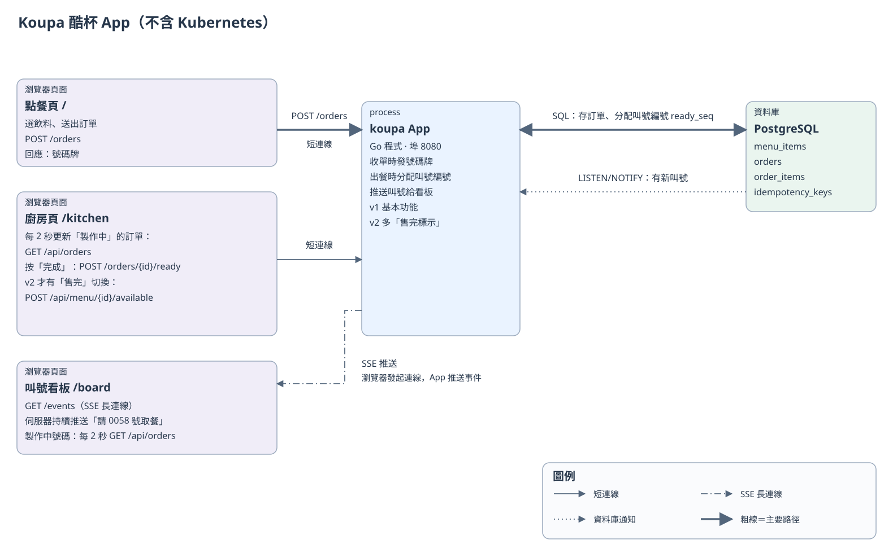
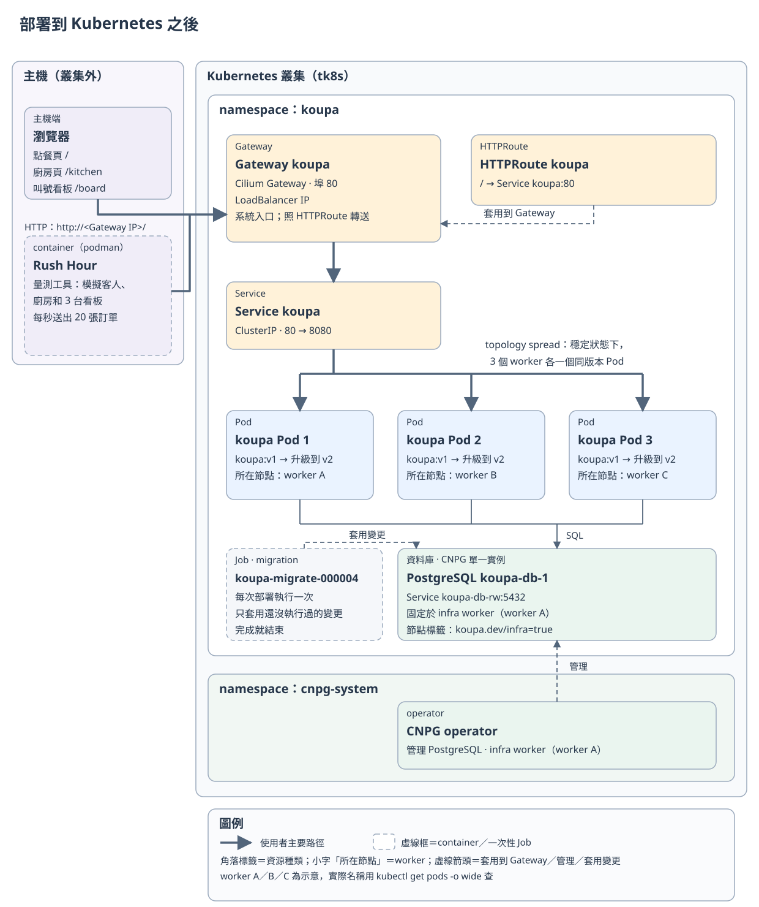

# Koupa 酷杯範例應用

> 微糖、去冰、零停機

這份文件介紹第一階段用的範例應用 Koupa 酷杯：它由哪些部分組成、怎麼部署到 Kubernetes、部署完怎麼確認連得到。升級時會出什麼問題、每一步怎麼修，請看[學生講義](../README.md)；講課要點請看[講師手冊](../TEACHER.md)。

Koupa 酷杯是一家虛構的手搖飲店。客人在點餐頁下單，拿到號碼牌；廚房做好後按「完成」；店裡的叫號看板跳出「請 0058 號取餐 🧋」。整個 App 是一支 Go 程式，資料存在 PostgreSQL：



| 部分 | 做什麼 | 和 App 之間的連線 |
|---|---|---|
| 點餐頁 `/` | 看飲料照片、用 −／＋ 選杯數，按「確認點餐」，拿到號碼牌 | 短連線：`POST /orders` |
| 廚房頁 `/kitchen` | 每 2 秒更新「製作中」的訂單，按「完成」出餐 | 短連線：`GET /api/orders`、`POST /orders/{id}/ready` |
| 叫號看板 `/board` | 左邊列出製作中的號碼；整張訂單都完成才叫號，右邊用大字顯示剛叫到的號碼 | 長連線：`GET /events`（SSE，伺服器持續把叫號推給瀏覽器）；製作中的號碼和廚房頁一樣每 2 秒用 `GET /api/orders` 更新 |
| koupa App | 收單時發號碼牌、出餐時分配叫號編號，再把叫號推送給看板；容器內聽 8080 埠 | — |
| PostgreSQL | 存菜單、訂單；用 LISTEN/NOTIFY（PostgreSQL 內建的通知機制）通知每個 App「有新的叫號」 | App 用 SQL 讀寫 |

這裡說的短連線指一次請求：送出、拿到回應就結束；長連線是看板的請求一直開著，叫號一出來就收到。第一階段要處理的，就是升級時這兩種連線各會出什麼問題。

三個頁面平常只顯示店裡用得到的資訊。上課要看是哪個版本、哪個 Pod 回應時，在網址後面加上 `?debug=1`（例如 `/board?debug=1`），畫面底部會多一條資訊列：服務版本、回應 `/api/whoami` 的 Pod 名稱（升級期間不一定是送出這個頁面的那一個）；看板還會顯示 SSE 連線狀態。

App 有兩個版本，分別放在兩個映像檔（用來啟動容器的程式包）裡，功能上的差別只有一項：

| 版本 | 映像檔 | 內容 |
|---|---|---|
| v1 | `ghcr.io/braveantony/koupa:v1` | 點餐、廚房、叫號看板 |
| v2 | `ghcr.io/braveantony/koupa:v2` | v1 再加上**售完標示**：廚房頁可以把品項設成售完；點餐頁重新載入菜單後，會把該品項顯示為灰色、不能點。已經開著的舊畫面如果照樣送出含售完品項的訂單，伺服器會回傳 422，拒絕這張訂單 |

售完標示只用到菜單表已經有的 `available` 欄位，不用改資料表結構。量測時做的版本變更就是「v1 升級到 v2」。

菜單有 4 個品項：波霸奶茶 65 元、晚霞紅茶 55 元、綠茶三劍客 55 元、冬瓜檸檬 50 元。品項名稱由 migration `000005_menu_names` 設定；飲料照片的來源見 [`app/web/img/CREDITS.md`](../app/web/img/CREDITS.md)。

## 開始之前

- 一個 tk8s 叢集，至少 3 個 worker（叢集裡執行 App 的節點），control plane 數量不限；叢集已經設定好 Cilium Gateway API、LoadBalancer IP 池，以及 StorageClass `local-path`。
- 主機（執行這些指令、而且連得到 Gateway IP 的那台電腦）上有 `git`、`kubectl`、`curl`、`python3`（含 PyYAML，`setup.sh` 用它檢查 migration 檔案是否齊全）；之後跑量測還需要 `podman`。
- `kubectl` 的目前 context（kubectl 要操作哪個叢集）指向這個叢集：

  ```bash
  kubectl config current-context
  kubectl get nodes
  ```

- 取得課程檔案，以下指令都在 `01/` 目錄執行：

  ```bash
  git clone https://github.com/braveantony/koupa.git
  cd koupa/01
  ```

完整的環境需求見[設計文件 6.1](design-v2/06-reference.md#61-環境需求)。

## 部署應用

App 不需要為 Kubernetes 做任何修改。部署完成後的樣子：



App 的資源都放在 namespace `koupa`（叢集裡用來分組資源的空間）；指令裡的 `-n koupa` 就是「操作這個空間」。

- **Gateway `koupa`**：系統入口。Cilium 會替它建一個 LoadBalancer Service（`cilium-gateway-koupa`），並從 IP 池分配一個可以從叢集外連線的 IP。
- **HTTPRoute `koupa`**：規定所有路徑（`/` 開頭）都轉給 Service `koupa` 的 80 埠。
- **Service `koupa`**：連到一組 Pod 的固定入口，80 埠對應到 Pod 的 8080 埠。
- **3 個 koupa Pod**：Pod 是 Kubernetes 執行程式的單位，每個 Pod 跑一份 App。不會排到 control plane。`topologySpreadConstraints`（Pod 分散規則）只計算同一版本的 Pod：在剛好 3 個可排程 worker 的課程環境裡，穩定狀態下 3 個 Pod 會分別在不同的 worker 上；升級期間新舊 Pod 並存，就不一定一台一個。圖上的 worker A／B／C 是示意，實際名稱用 `kubectl get pods -o wide` 查。
- **PostgreSQL `koupa-db`**：由 CNPG operator（在 Kubernetes 上管理 PostgreSQL 的程式）建立的單一實例，App 透過 Service `koupa-db-rw:5432` 連線。資料庫和 operator 都固定在 infra worker（貼了 `koupa.dev/infra=true` 標籤的 worker，預設是名稱排序後的第一個 worker），讓其他 worker 可以拿來做 drain 實驗。
- **migration Job**：每次部署執行一次，照編號套用還沒執行過的資料庫變更；第一次執行時會建立資料表、放入菜單。完成後就結束。

### 啟動服務

1. 執行部署腳本：

   ```bash
   ./setup.sh
   ```

   `setup.sh` 分段執行，任何一段失敗就停下來並印出原因：
   1. 選 infra worker、安裝 CNPG operator（固定 v1.30.1），建立資料庫 `koupa-db`，等它可以連線；
   2. 執行 migration Job，等它成功；
   3. 部署 App、Service、Gateway 和 HTTPRoute（[步驟 0](../README.md#步驟-0什麼都不做)的設定），最後印出 Gateway 的 IP。

   `setup.sh` 可以重跑：已經存在的資源會更新，migration Job 會先刪掉再重建。

2. 確認 Service 都建好了：

   ```bash
   kubectl -n koupa get services
   ```

   ```
   NAME                   TYPE           CLUSTER-IP    EXTERNAL-IP    PORT(S)        AGE
   cilium-gateway-koupa   LoadBalancer   10.98.2.216   172.22.2.201   80:31340/TCP   9m23s
   koupa                  ClusterIP      10.98.2.248   <none>         80/TCP         9m23s
   koupa-db-r             ClusterIP      10.98.2.46    <none>         5432/TCP       10m
   koupa-db-ro            ClusterIP      10.98.2.249   <none>         5432/TCP       10m
   koupa-db-rw            ClusterIP      10.98.2.233   <none>         5432/TCP       10m
   ```

   `koupa-db-r`、`koupa-db-ro`、`koupa-db-rw` 是 CNPG 自動建立的；App 只用 `koupa-db-rw`（可以寫入的那一台）。IP 每個叢集都不一樣。

3. 確認 Pod 的狀態：

   ```bash
   kubectl -n koupa get pods -o wide
   ```

   ```
   NAME                         READY   STATUS      RESTARTS   AGE     IP              NODE
   koupa-66d75c5658-bkrxs       1/1     Running     0          9m23s   10.244.21.234   tkcicd-1-worker-3
   koupa-66d75c5658-sfnjg       1/1     Running     0          9m23s   10.244.20.204   tkcicd-1-worker-2
   koupa-66d75c5658-w6gb6       1/1     Running     0          9m23s   10.244.19.111   tkcicd-1-worker-1
   koupa-db-1                   1/1     Running     0          9m51s   10.244.19.225   tkcicd-1-worker-1
   koupa-migrate-000005-gdxtj   0/1     Completed   0          9m30s   10.244.21.239   tkcicd-1-worker-3
   ```

   3 個 `koupa-` Pod 和 `koupa-db-1` 都要是 `Running`；3 個 `koupa-` Pod 分在不同 worker，`koupa-db-1` 在 infra worker。migration Job 的 Pod 如果還看得到，`Completed` 表示它已經成功結束；完成 24 小時後它會自動刪除。

### 查 Gateway 的 IP

`setup.sh` 最後會印出 Gateway 的 IP。後面的 `curl` 會用到變數 `GATEWAY_IP`，請在同一個終端機視窗執行下面兩行；換了視窗要重新執行：

```bash
export GATEWAY_IP=$(kubectl -n koupa get gateway koupa -o jsonpath='{.status.addresses[0].value}')
echo "$GATEWAY_IP"
```

## 從叢集外確認連得到

在主機上執行：

```bash
curl -s "http://$GATEWAY_IP/" | grep -o "<title>.*</title>"
```

```
<title>Koupa 酷杯 - 點餐</title>
```

再看是哪個 Pod 回應的。每個回應都帶一個 header（回應附帶的欄位）`x-koupa-pod-uid`，值是處理這個請求的 Pod 的識別碼（UID）：

```bash
curl -s -i "http://$GATEWAY_IP/api/menu" | grep -i x-koupa-pod-uid
```

```
x-koupa-pod-uid: 8005b822-780c-4a72-afbd-4092dea74d3a
```

多執行幾次，可能會看到不同的識別碼；不保證每次都不同，也不一定很快就看到全部 3 個。

看板的長連線也可以用 `curl` 看。連上後伺服器會先送 `hello` 事件，按 Ctrl-C 結束：

```bash
curl -N "http://$GATEWAY_IP/events"
```

```
event: hello
id: 6000
data: {"version":"v1"}
```

看到 `hello` 表示 `curl` 建立了和看板相同的事件連線；`version` 是目前連線的 App 版本。`id` 是給看板重連補號用的，細節見[步驟 4](../README.md#步驟-4重連後補號)。

最後用瀏覽器試一次完整流程。把下面網址裡的 `<Gateway IP>` 換成剛才查到的 IP，分別開三個分頁，看板那一頁保持開著（想看服務版本和 Pod，就在網址後面加上 `?debug=1`）：

| 頁面 | 網址 |
|---|---|
| 點餐 | `http://<Gateway IP>/` |
| 廚房 | `http://<Gateway IP>/kitchen` |
| 叫號看板 | `http://<Gateway IP>/board` |

在點餐頁按飲料旁的 ＋ 選一杯，再按下方的「確認點餐」，記下畫面上的號碼牌；看板左邊的「製作中」會出現這個號碼。到廚房頁找到這張單按「完成」，看板右邊的「請取餐」就會叫到這個號碼。

## 切換 v1 和 v2

量測時，`measure.sh` 會自己換版本：步驟 0～5 每次從 v1 開始、量測中升級到 v2，`rollback` 則從 v2 退回 v1；`control`、`drain`、`scale-down` 不換版本。平常不用手動切換。只想在瀏覽器看看 v2 的售完功能，可以手動換映像檔：

```bash
kubectl -n koupa set image deployment/koupa koupa=ghcr.io/braveantony/koupa:v2
kubectl -n koupa rollout status deployment/koupa
```

重新整理廚房頁，下方會多出「品項供應」區，每個品項旁邊有「設為售完」按鈕；打開 `/board?debug=1`，底部資訊列會顯示「服務版本：v2」。

看完換回 v1。售完狀態存在資料庫裡，換映像檔不會恢復；如果剛才把品項設成售完，先在廚房頁按「恢復供應」再換：

```bash
kubectl -n koupa set image deployment/koupa koupa=ghcr.io/braveantony/koupa:v1
kubectl -n koupa rollout status deployment/koupa
```

v1 不檢查售完，所以 rolling update 期間，客人如果被分到還沒換掉的 v1 Pod，售完的品項還是點得到。這是新舊版同時運作的真實狀況，第二階段會再談。

## 接下來

App 部署好之後，回到[學生講義](../README.md)：先做閒置看板的小實驗，再依序量測步驟 0～5，看升級時的「送出失敗」、「看板漏號」和「重複訂單」，以及每一步怎麼降低這些問題。

App 的資料表、識別碼和設計理由見[設計文件第 3 章](design-v2/03-app-and-data.md)。

## 清除

下面的指令會刪除整個 namespace `koupa` 和裡面的資料，並移除 GatewayClass `koupa` 和所有節點上的 `koupa.dev/infra` 標籤。執行前請先確認這些資源沒有拿去做別的用途，要保留的資料先備份。照順序刪：

```bash
# 1. App、資料庫和資料（PVC 會一起刪除；tk8s 的 local-path 回收政策是 Delete，
#    PV 和節點上的資料也會刪掉。可以用 kubectl get sc local-path 確認 RECLAIMPOLICY）
kubectl delete namespace koupa

# 2. 叢集層級的資源：GatewayClass
kubectl delete gatewayclass koupa
```

接著處理 CNPG operator。它是叢集共用的元件，`setup.sh` 把它固定在 infra worker 上（設定了 `nodeSelector`），所以要先決定刪不刪它，再移除標籤：

- **刪除 operator**：確認叢集裡沒有其他程式在用 CNPG 才刪：

  ```bash
  kubectl delete -f https://github.com/cloudnative-pg/cloudnative-pg/releases/download/v1.30.1/cnpg-1.30.1.yaml
  kubectl label nodes -l koupa.dev/infra=true koupa.dev/infra-
  ```

- **保留 operator**：先拿掉 `setup.sh` 加上的 `nodeSelector`，等它重新啟動，再移除標籤；否則它之後重新排程時會找不到節點：

  ```bash
  kubectl -n cnpg-system patch deployment cnpg-controller-manager --type json \
    -p '[{"op":"remove","path":"/spec/template/spec/nodeSelector"}]'
  kubectl -n cnpg-system rollout status deployment/cnpg-controller-manager
  kubectl label nodes -l koupa.dev/infra=true koupa.dev/infra-
  ```

Rush Hour 的映像檔在主機上，不用時可以用 `podman rmi ghcr.io/braveantony/rush-hour:0.1.0` 刪掉。
