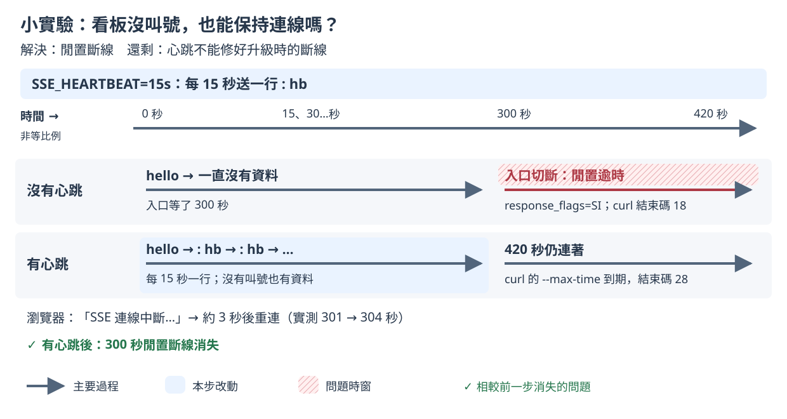

# 小實驗：閒置的看板會不會斷

## 這一步要解決什麼

確認看板連著但一直沒有叫號時，會不會被入口切斷。

這和升級無關，所以排在量測之前做。先認識「長連線本身就會斷」，後面才不會把它和升級的問題混在一起。

## 開始之前

- 已經照 [README 2. 部署](../../README.md#2-部署)部署好。
- **不要同時跑 `measure.sh`，也不要在廚房頁按「完成」**（下了單就會想按，所以也先不要下單），因為一有叫號，連線就不算閒置，也就不會被切斷。

開好視窗（`<IP>` 的查法見 [README 2. 部署](../../README.md#2-部署)）：

| 視窗 | 內容 | 必要？ |
|---|---|---|
| 終端機 A | 下面「怎麼做」的 `curl` | 必要 |
| 終端機 B | 做完後查入口的紀錄 | 建議 |
| 瀏覽器（要連得到 Gateway IP，例如主機上的瀏覽器或課程的 desktop container） | 只開 `http://<IP>/board?debug=1` | 選用，只看不操作 |

瀏覽器的看板也是一條閒置的長連線，同樣會在它自己連上後第 300 秒被切斷。

## 改了什麼

先用 `k8s/base`（沒有心跳）做一次，再套用 `k8s/idle-lab` 做一次。`k8s/idle-lab/kustomization.yaml` 只加一個環境變數：

```yaml
env:
  - name: SSE_HEARTBEAT
    value: 15s
```

打開後，App 每 15 秒對每條看板連線送一行心跳 `: hb`（以 `:` 開頭的註解行，瀏覽器會忽略）。

選用：看完整的設定差異（讀法見[量測說明](measure.md#看設定差異選用)）：

```bash
diff <(kubectl kustomize k8s/base) <(kubectl kustomize k8s/idle-lab)
```

## 怎麼做

在 `01/` 目錄執行。先做沒有心跳的一組：

```bash
GW=$(kubectl -n koupa get gateway koupa -o jsonpath='{.status.addresses[0].value}')
kubectl apply -k k8s/base && kubectl -n koupa rollout status deploy/koupa
curl -N --max-time 420 http://$GW/events; echo "curl 結束碼 $?"
```

結束後套用心跳設定，再做一次：

```bash
kubectl apply -k k8s/idle-lab && kubectl -n koupa rollout status deploy/koupa
curl -N --max-time 420 http://$GW/events; echo "curl 結束碼 $?"
```

在終端機 B 查入口的紀錄（`response_flags` 是入口記下的結束原因）。一行是一條已經結束的連線；用 `duration_ms`（約 300000 和 420000）找到你的那幾行：

```bash
kubectl -n kube-system logs -l k8s-app=cilium-envoy --since=20m --tail=-1 --prefix | grep '"path":"/events"'
```

兩組連線加起來約 12 分鐘（300＋420 秒）。做完不用還原，因為之後 `measure.sh` 會套用各步驟自己的設定，心跳會被拿掉。

## 過程中看什麼

以下是 2026-11-11 在 tkha（講師的實測環境）上的一次實測。

**終端機 A，沒有心跳**：收到 `hello` 事件之後就沒有任何資料。

```
event: hello
id: 156912
data: {"version":…}
```

第 301 秒 curl 結束，印出 `curl 結束碼 18`（前面還會有一行 `curl: (18) …`，是預期的）。

**終端機 A，有心跳**：`hello` 之後每 15 秒多一行 `: hb`，一直到第 420 秒 curl 自己設定的 `--max-time` 時間到，印出 `curl 結束碼 28`（前面同樣會有一行 `curl: (28) …`）。

**瀏覽器的看板**：

- 沒有心跳：第 301 秒資訊列變成 `SSE 連線中斷，瀏覽器正在重新連線…`，第 304 秒又是 `SSE 已連線`。中間約 3～5 秒是瀏覽器自己預設的重連等待時間（Chromium 3 秒、Firefox 5 秒；這次的觀察用 Chromium）。瀏覽器會自動重連，所以畫面上只是閃一下；
- 有心跳：從頭到尾都是 `SSE 已連線`。

**終端機 B**：沒有心跳的那兩條連線（`curl` 和瀏覽器）記成 `"response_flags":"SI"`、`"response_code_details":"stream_idle_timeout"`，`"duration_ms"` 分別是 300004 和 300007；有心跳的 `curl` 記成 `"response_flags":"DC"`（用戶端自己斷線）、`"duration_ms":420010`。

## 你應該看到

講師的結果（2026-11-10）：

| 設定 | curl | 入口紀錄 |
|---|---|---|
| 沒有心跳 | 第 300 秒被切斷，結束碼 18（回應不完整） | `response_flags` 是 `SI`（閒置逾時），`duration_ms` 300001 |
| 有心跳 | 每 15 秒一行 `: hb`，420 秒都沒斷，結束碼 28（curl 自己設定的 `--max-time` 時間到） | `response_flags` 是 `DC`，`duration_ms` 420010 |

秒數差一兩秒沒關係，要看的是：沒有心跳時在 300 秒左右斷線，原因是 `SI`；有心跳時撐到 420 秒。

## 為什麼會這樣



- 入口（Cilium Gateway 底下的 Envoy）有一個閒置逾時 `stream_idle_timeout`，設定是 300 秒。一條連線 300 秒都沒有資料，入口就切斷它，和有沒有升級無關。
- 心跳讓連線每 15 秒就有資料，永遠不會閒置到 300 秒。
- 心跳只對「閒置」有效。如果入口限制的是連線的總時間（例如 HTTPRoute 寫了 `timeouts`），有心跳也照樣會斷。Koupa 的 HTTPRoute 沒寫 `timeouts`，所以沒有這個限制。
- 步驟 0～5 不開心跳，因為量測時每秒都有叫號，連線不會閒置。

完整說明見[設計文件 4.3 閒置斷線小實驗](../design-v2/04-step-mechanisms.md#43-閒置斷線小實驗)。

## 出問題時

- **不到 300 秒就斷了**：可能是 Pod 被換掉，或連線發生其他問題。先確認沒有人在跑 `measure.sh`，再用 `kubectl -n koupa get pods` 檢查 Pod 有沒有重啟；記下入口紀錄並請講師確認。
- **沒有心跳也超過 300 秒沒斷**：可能有叫號讓連線不算閒置（`curl` 會印出 `event: ready`），或是你環境裡入口的逾時不是 300 秒。記下秒數和入口紀錄，請講師確認。
- **入口紀錄查不到**：`--since=20m` 只查最近 20 分鐘，做完隔太久才查，就把時間改長一點，例如 `--since=1h`。
- **curl 結束碼不是 18 或 28**：例如 7 是連不上，先確認 `$GW` 有值（`echo $GW`）。

---

[回 README](../../README.md)｜[量測說明 →](measure.md)
