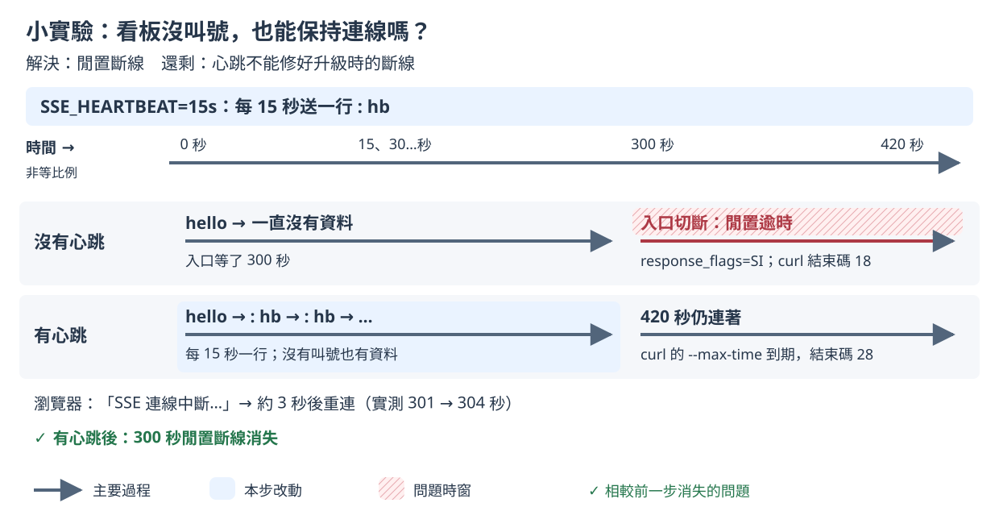

# 小實驗：閒置的看板會不會斷

> 約 15 分鐘｜需要：部署好的環境、兩個終端機（瀏覽器選用）｜不要同時跑 `measure.sh`

## 這一步要解決什麼

確認看板連著但一直沒有叫號時，會不會被入口（Cilium Gateway，從叢集外連進來的連線都先經過它）切斷。

這和升級無關，所以排在量測之前做。先認識「長連線本身就會斷」，後面才不會把它和升級的問題混在一起。

## 開始之前

- 已經照 [README 2. 部署](../../README.md#2-部署)部署好。
- **不要同時跑 `measure.sh`，也不要在廚房頁按「完成」**（下了單就會想按，所以也先不要下單），因為一有叫號，連線就不算閒置，也就不會被切斷。

開好視窗（`<IP>` 就是下面 `echo $GW` 印出的值，查法見 [README 2. 部署](../../README.md#2-部署)）：

| 視窗 | 內容 | 必要？ |
|---|---|---|
| 終端機 A | 下面「怎麼做」的 `curl` | 必要 |
| 終端機 B | 做完後查入口紀錄 | 建議 |
| 瀏覽器（要連得到 Gateway IP，例如主機上的瀏覽器或課程的 desktop container） | 只開 `http://<IP>/board?debug=1` | 選用，只看不操作 |

沒有心跳時，瀏覽器的看板也是一條閒置的長連線，同樣會在它自己連上後第 300 秒被切斷。

## 改了什麼

先用 `k8s/base`（沒有心跳，也就是 App 不會定期送資料）做一次，再套用 `k8s/idle-lab` 做一次。`k8s/idle-lab/kustomization.yaml` 只加一個環境變數：

```yaml
env:
  - name: SSE_HEARTBEAT
    value: 15s
```

**映像檔沒有換**，心跳的程式本來就在 App 裡，這個環境變數只決定要不要打開。打開後，App 每 15 秒對每條看板連線送一行心跳 `: hb`（以 `:` 開頭的註解行，瀏覽器會忽略）。從設定到送出的流程：

`SSE_HEARTBEAT` → 啟動時讀設定 → 每條看板連線開一個每 15 秒響一次的計時器 → 計時器一響就寫出 `: hb` → `Flush` 立刻送出

<details>
<summary><b>看程式碼怎麼做到的</b>（四個地方，約 3 分鐘）</summary>

**① 啟動時讀設定**：[`app/config/config.go:120`](../../app/config/config.go#L120)

```go
durVar(&cfg.SSEHeartbeat, "SSE_HEARTBEAT", 0)
```

沒設定時是 `0`，也就是關閉。值是一段時間長度，數字後面要加單位，例如 `15s`、`1m`。

**② 每條看板連線開一個計時器**：[`app/board/handler.go:253`](../../app/board/handler.go#L253-L258)

```go
var hb <-chan time.Time
if h.Cfg.SSEHeartbeat > 0 {
	t := time.NewTicker(h.Cfg.SSEHeartbeat)
	defer t.Stop()
	hb = t.C
}
```

每台看板連上 `/events` 時，App 都會替這條連線開一個每 15 秒響一次的計時器（`time.NewTicker`）。設定是 `0` 時不開計時器，`hb` 保持空值（`nil`），下一段的 `case <-hb` 永遠等不到東西，心跳就等於關閉。

**③ 主迴圈等到什麼就做什麼**：[`app/board/handler.go:259`](../../app/board/handler.go#L259)（節錄並簡化，省略錯誤處理）

```go
for {
	select {
	case <-ctx.Done():   // 對方斷線（看板離開，或入口切斷）→ 結束
	// …（另有一個 case：看板讀太慢時結束連線，這裡省略）
	case <-h.Shutdown:   // App 要關閉 → 送 shutdown 事件（步驟 3 才用到）
	case ev := <-ch:     // 有新的叫號 → 送 ready 事件
		sw.write(encodeReady(ev))
	case <-hb:           // 計時器響了 → 送一行心跳
		sw.write(hbData)
	}
}
```

程式會停在 `select` 這裡等，哪一個先發生就處理哪一個。沒有心跳時，只要沒有叫號，程式就一直等在這裡，連線上沒有任何資料；有心跳時，每 15 秒會執行一次最後一個 `case`。叫號不會讓計時器重新計時，所以有叫號時心跳照樣每 15 秒送一次。

**④ 心跳的內容和送出方式**：[`app/board/sse.go:48`](../../app/board/sse.go#L48)、[`app/board/handler.go:366`](../../app/board/handler.go#L366-L369)

```go
var heartbeat = []byte(": hb\n")
```

```go
_, err := s.w.Write(b)
if err == nil {
	err = s.rc.Flush()
}
```

- 心跳只有 5 個位元組：`: hb` 加換行。SSE 規定以 `:` 開頭的行是註解，瀏覽器內建的 `EventSource`（用來接收 SSE 的物件）收到後直接忽略，不會觸發任何事件。所以看板的 [`app/web/app.js`](../../app/web/app.js#L459) 完全不用改，它只處理 `hello`、`ready`、`shutdown` 這幾種事件。
- 每次寫完都會呼叫 `Flush`，把資料立刻送出去。不呼叫的話，這幾個位元組可能留在 App 的緩衝區，入口收不到資料，連線照樣算閒置。

</details>

選用：看完整的設定差異（讀法見[量測說明](measure.md#看設定差異選用)）：

```bash
diff <(kubectl kustomize k8s/base) <(kubectl kustomize k8s/idle-lab)
```

## 怎麼做

在終端機 A、`01/` 目錄執行。先做沒有心跳的一組：

```bash
GW=$(kubectl -n koupa get gateway koupa -o jsonpath='{.status.addresses[0].value}')
kubectl apply -k k8s/base && kubectl -n koupa rollout status deploy/koupa
curl -N --max-time 420 http://$GW/events; echo "curl 結束碼 $?"
```

`/events` 是看板用來接收叫號的長連線（SSE）；`-N` 讓 curl 收到資料就立刻印出；`--max-time 420` 是最多等 420 秒，比 300 秒長，才看得出有沒有被切斷。

結束後在同一個終端機套用心跳設定，確認 App 讀到設定，再做一次（換了終端機的話，`$GW` 要重新設定）：

```bash
kubectl apply -k k8s/idle-lab && kubectl -n koupa rollout status deploy/koupa
kubectl -n koupa logs deploy/koupa | grep '"event":"startup"' | grep -o '"sse_heartbeat":"[^"]*"'
curl -N --max-time 420 http://$GW/events; echo "curl 結束碼 $?"
```

第二行查的是 Pod 啟動時印出的 `startup` 紀錄（[`app/main.go:54`](../../app/main.go#L54)），應該看到 `"sse_heartbeat":"15s"`；套用 `k8s/base` 時是 `"0s"`。前面多一行 `Found 3 pods, using pod/…` 是正常的，表示 kubectl 從 3 個 Pod 挑一個來看。

兩組都做完後，在終端機 B 查入口紀錄（`response_flags` 是入口記下的結束原因）。一行是一條已經結束的連線；用 `duration_ms`（約 300000 和 420000）找到你的那幾行：

```bash
kubectl -n kube-system logs -l k8s-app=cilium-envoy --since=20m --tail=-1 --prefix | grep '"path":"/events"'
```

兩組連線加起來約 12 分鐘（300＋420 秒）。做完不用還原，因為之後 `measure.sh` 會套用各步驟自己的設定，心跳會被拿掉。

## 過程中看什麼

**終端機 A**：連上後先收到一個 `hello` 事件。

```
event: hello            ← 連上時送一次
id: 156912
data: {"version":…}

: hb                    ← 有心跳時才有：第 15 秒
: hb                    ← 第 30 秒
…
```

- 沒有心跳：`hello` 之後就沒有任何資料，第 300 秒左右 curl 結束，先印出一行 `curl: (18) …`（這是預期的），再印出 `curl 結束碼 18`。
- 有心跳：每 15 秒多一行 `: hb`，直到第 420 秒 curl 自己設定的 `--max-time` 時間到，先印出一行 `curl: (28) …`（也是預期的），再印出 `curl 結束碼 28`。

**瀏覽器的看板**：

- 沒有心跳：第 300 秒左右資訊列變成 `SSE 連線中斷，瀏覽器正在重新連線…`，3～5 秒後又變回 `SSE 已連線`。這段等待是瀏覽器預設的重連間隔（Chromium 3 秒、Firefox 5 秒）。瀏覽器會自動重連，所以畫面上只是閃一下。
- 有心跳：從頭到尾都是 `SSE 已連線`。

## 你應該看到

講師的結果（2026-11-10）：

| 設定 | curl | 入口紀錄 |
|---|---|---|
| 沒有心跳 | 第 300 秒被切斷，結束碼 18（回應不完整） | `"response_flags":"SI"`（stream idle，閒置逾時）、`"response_code_details":"stream_idle_timeout"`、`"duration_ms":300001` |
| 有心跳 | 420 秒都沒斷，結束碼 28（curl 自己設定的 `--max-time` 時間到） | `"response_flags":"DC"`（downstream connection termination，用戶端自己斷線）、`"duration_ms":420010` |

有開瀏覽器的看板的話，沒有心跳時入口紀錄裡會再多一行以上的 `SI`，就是瀏覽器那條連線（瀏覽器每次重連後，再閒置 300 秒又會被切一次）。

秒數差一兩秒沒關係，另一次實測（2026-11-11）的 `duration_ms` 是 300004、300007 和 420010。要看的是：沒有心跳時在 300 秒左右斷線，原因是 `SI`；有心跳時撐到 420 秒。

## 為什麼會這樣



- 入口（Cilium Gateway 底下的 Envoy）有一個閒置逾時 `stream_idle_timeout`，Cilium 預設是 300 秒。一條連線 300 秒都沒有資料，入口就切斷它，和有沒有升級無關。
- 心跳讓連線每 15 秒就有資料，永遠不會閒置到 300 秒。
- 心跳只對「閒置」有效。如果入口限制的是連線的總時間（例如 HTTPRoute 寫了 `timeouts`），有心跳也照樣會斷。Koupa 的 HTTPRoute 沒寫 `timeouts`，所以沒有這個限制。
- 步驟 0～5 不開心跳，因為量測時每秒都有叫號，連線不會閒置。

完整說明見[設計文件 4.3 閒置斷線小實驗](../design-v2/04-step-mechanisms.md#43-閒置斷線小實驗)。

## 出問題時

<details>
<summary>結果和上面不一樣時，點開看怎麼處理</summary>

- **不到 300 秒就斷了**：可能是 Pod 被換掉，或連線發生其他問題。先確認沒有人在跑 `measure.sh`，再用 `kubectl -n koupa get pods` 檢查 Pod 有沒有重啟；記下入口紀錄並請講師確認。
- **沒有心跳也超過 300 秒沒斷**：可能有叫號讓連線不算閒置（`curl` 會印出 `event: ready`），或是你環境裡入口的逾時不是 300 秒。記下秒數和入口紀錄，請講師確認。
- **`sse_heartbeat` 不是 `15s`**：確認套用的是 `k8s/idle-lab`，而且 `rollout status` 已經跑完。
- **`rollout status` 一直不結束**：多半是 `SSE_HEARTBEAT` 的值格式不對（例如只寫 `15`），新的 Pod 一啟動就印出 `koupa: config: SSE_HEARTBEAT: "15" is not a non-negative duration such as 15s` 然後結束（[`app/main.go:35`](../../app/main.go#L35-L36)），不斷重啟。用 `kubectl -n koupa get pods` 找出狀態是 `CrashLoopBackOff` 的 Pod，再用 `kubectl -n koupa logs <那個 Pod 的名稱>` 看錯誤。舊的 Pod 會留著繼續服務，所以 `kubectl -n koupa logs deploy/koupa` 可能挑到舊的 Pod，看不到這個錯誤。
- **入口紀錄查不到**：`--since=20m` 只查最近 20 分鐘，做完隔太久才查，就把時間改長一點，例如 `--since=1h`。
- **curl 結束碼不是 18 或 28**：例如 6 多半是 `$GW` 沒有值（用 `echo $GW` 確認），7 是有 IP 但連不上。

</details>

---

[← 網路](00-network.md)｜[回 README](../../README.md)｜[量測說明 →](measure.md)
