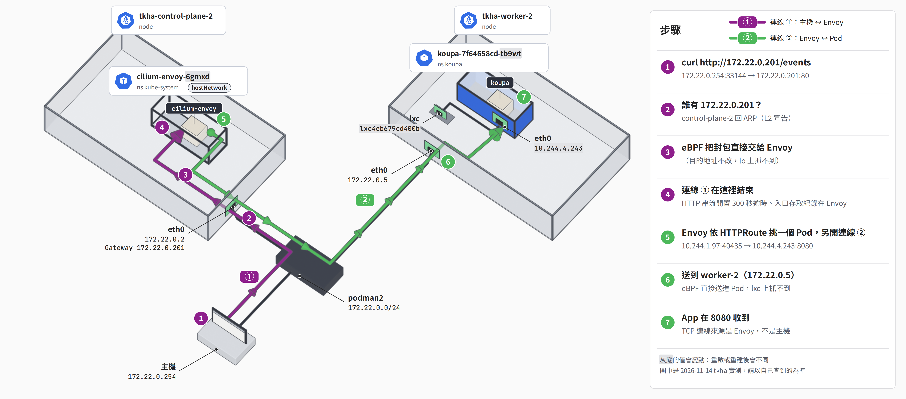

# 網路：一個請求怎麼走到 Pod

> 約 15 分鐘｜需要：部署好的環境、一個終端機｜只查看，不會改動叢集

## 這一步要解決什麼

後面的步驟都在處理「升級時，請求送到還沒準備好或快要關掉的 Pod」和「看板斷線」。要看懂這些問題出在哪一段，得先知道一個請求從主機出發後經過哪些地方。這一篇把 Koupa 用到的三段網路講清楚：

1. **主機 → 入口 → Pod**：客人下單、廚房按完成、看板連線都走這條；
2. **Pod → PostgreSQL**：App 存取訂單和叫號；
3. **升級時入口的名單怎麼更新**：新 Pod 什麼時候加進來（步驟 1 處理）、舊 Pod 什麼時候拿掉（步驟 2 處理）。

每一段都附了「自己查」的指令，只查看、不修改，可以跳過。文中的數值是講師在 tkha 上的實測（入口是 2026-11-14 和 2026-11-17，資料庫和升級是 2026-11-17），IP、Pod 名稱、節點在你的環境裡都會不同。

## 開始之前

- 已經照 [README 2. 部署](../../README.md#2-部署)部署好。
- 在 `01/` 目錄開一個終端機，先記下 Gateway 的 IP：

```bash
GW=$(kubectl -n koupa get gateway koupa -o jsonpath='{.status.addresses[0].value}'); echo $GW
```

## 全景

```
主機（叢集外）：瀏覽器、curl、Rush Hour
      │  ① 主機 ↔ 入口（TCP 連線一）
      ▼
入口：某一個節點上的 Envoy（Cilium Gateway）
      │  ② 入口 ↔ Pod（TCP 連線二，Envoy 另外開的）
      ▼
koupa Pod（3 個，分在不同的 worker）
      │  ③ Pod ↔ PostgreSQL（連線池＋一條 LISTEN 連線）
      ▼
koupa-db-1（在其中一台 worker 上，這台稱為 infra worker）
```

- 三種用戶端走的路完全一樣，差別只在連線維持多久：下單和按完成是**短連線**（送一個請求、收到回應就結束）；看板是**長連線**（SSE，Server-Sent Events：連上後不關，App 有新叫號就推給看板）。
- 一個請求會經過**兩條 TCP 連線**：主機只連到入口，入口再另外連到 Pod。所以 Pod 看到的連線來源是入口，不是主機。

## 路徑 1：主機 → 入口 → Pod



可以旋轉的 3D 版本：[看板連線 3D](https://claude.ai/artifact/5vL6cUKmDVpDSyYYRwT7qB)（會一步一步顯示封包走到哪裡）。

圖是 2026-11-14 用 `curl http://$GW/events`（看板的連線）實測的結果。編號照圖，不完全是時間順序，例如第 2 步的 ARP 其實發生在第 1 步的封包送出之前：

| 順序 | 發生什麼事 | 2026-11-14 的實測值 |
|---|---|---|
| 1 | 主機送出連線，目的地是 Gateway IP 的 80 埠 | `172.22.0.254:33144 → 172.22.0.201:80` |
| 2 | 主機先在區域網路上廣播問「Gateway IP 是哪張網卡」（ARP），被選中的那個節點回覆自己網卡的硬體位址（MAC） | control-plane-2 回覆 |
| 3 | 封包進到那個節點，eBPF（Cilium 掛在 Linux 核心裡的小程式）直接交給同一個節點上的 Envoy，目的位址不變 | — |
| 4 | 連線 ① 只到 Envoy 為止。閒置逾時在這裡計算，入口的紀錄（access log）也在這裡寫下 | — |
| 5 | Envoy 照 HTTPRoute（轉送規則）從 3 個 Pod 挑一個，用所在節點的一個 `10.244.x.x` 位址（不是節點 IP）另開連線 ② | `10.244.1.97:40435 → 10.244.4.243:8080` |
| 6 | 封包經過節點之間的網路（podman2）送到 Pod 所在的 worker，eBPF 直接送進 Pod | — |
| 7 | App 在 8080 埠收到連線，來源是 Envoy | — |

講師用 tcpdump（抓封包的工具）在節點的 `lo`（本機回送網卡）和 Pod 在節點上對應的 `lxc` 網卡都看不到這些封包，因為 eBPF 直接把封包交給目的地，跳過了它們。

**入口在哪個節點不是固定的**：由哪個節點回應 Gateway IP，是 Cilium 的 L2 廣播（L2 announcement：選一個節點負責回答這個 IP 的 ARP）決定的。負責的節點出問題或叢集重新開機後，可能換成別的節點：2026-11-14 是 control-plane-2，2026-11-17 叢集重新開機後變成 control-plane-1，連線 ② 的來源也跟著變成 `10.244.0.99`。走法一樣，只有 IP 不同；Pod 重新建立後，Pod IP 也會變。

**自己查**（選用）：

```bash
# 現在由哪個節點負責 Gateway IP
kubectl -n kube-system get lease cilium-l2announce-koupa-cilium-gateway-koupa -o jsonpath='{.spec.holderIdentity}'; echo
# 3 個 Pod 的 IP 和所在節點，也就是連線 ② 的目的地
kubectl -n koupa get pods -l app.kubernetes.io/name=koupa -o wide
```

想確認主機真的把封包送到那個節點，可以比對 MAC（要在連得到 Gateway IP 的主機上執行）：

```bash
kubectl get nodes -o wide          # 找出負責節點的 INTERNAL-IP，填到下一行的 <節點 IP>
ping -c1 <節點 IP> >/dev/null; ip neigh show <節點 IP>
curl -s -o /dev/null http://$GW/; ip neigh show $GW
```

兩行 `ip neigh` 印出的 `lladdr` 相同，就表示 Gateway IP 落在那個節點上。

## 路徑 2：Pod → PostgreSQL

App 用 `koupa-db-rw.koupa` 這個名稱連資料庫。`koupa-db-rw` 是一個 Service（Kubernetes 給一組 Pod 的固定名稱和 IP），連線字串由資料庫的安裝程式（CNPG）產生。名稱要先換成 IP，所以這條路分兩段：

| 順序 | 發生什麼事 | 2026-11-17 的實測值 |
|---|---|---|
| 1 | App 啟動、要連資料庫時查 DNS。Pod 的 DNS 設定會讓程式依序補上幾個後綴（search domain）去試，第一個試的是 `koupa-db-rw.koupa.koupa.svc…`，查不到（NXDomain） | 查詢送到 CoreDNS 的 Pod（這次有兩個：`10.244.2.180`、`10.244.5.252`，每次查詢挑一個） |
| 2 | 試到 `koupa-db-rw.koupa.svc.<叢集網域>` 就查到了，答案是 Service 的 IP | `10.98.0.219` |
| 3 | App 連到 Service IP 的 5432 埠。Cilium 在程式建立連線的那一刻就把目的地換成資料庫 Pod 的 IP，所以封包離開 App 的 Pod 時，目的地已經是資料庫 Pod 的 IP | `10.244.4.48 → 10.244.3.73:5432` |
| 4 | 封包經過 podman2 送到 infra worker 上的 `koupa-db-1`。和資料庫在同一台 worker 的那個 koupa Pod 不經過 podman2 | — |

- **封包的位址不是 Service IP**：DNS 的 Service IP（`10.98.0.10`）和資料庫的 Service IP（`10.98.0.219`），都沒有出現在封包的來源或目的位址上；講師在三個 worker 的 `eth0` 抓到的，都是 Pod IP。Service IP 只出現在 DNS 回應的內容裡，以及程式和 Cilium 之間。
- 平常（沒有流量時），每個 Pod 的 App 對資料庫開**兩種連線**：一般查詢用的連線池，以及一條專門等 `LISTEN` 通知的連線（有新叫號時 PostgreSQL 會通知它，App 再推給看板）。查詢一多，連線池會再多開。
- 叢集剛開機時，如果 CoreDNS 還沒準備好，App 會因為查不到 `koupa-db-rw` 而啟動失敗、自動重啟（紀錄裡是 `lookup koupa-db-rw.koupa on 10.98.0.10:53: … connection refused`），等 DNS 準備好就恢復正常。2026-11-17 重新開機後，`kubectl get pods` 的 RESTARTS 欄是 28～30 次。

**自己查**（選用）：

```bash
# 資料庫的 Service 和它背後的 Pod IP
kubectl -n koupa get svc koupa-db-rw
kubectl -n koupa get endpointslice -l kubernetes.io/service-name=koupa-db-rw
kubectl -n koupa get pods koupa-db-1 -o wide
# DNS 的 Service 和 CoreDNS 的 Pod
kubectl -n kube-system get svc kube-dns
kubectl -n kube-system get pods -l k8s-app=kube-dns -o wide
```

## 升級時入口的名單怎麼更新

入口不會自己去檢查 Pod，它照一份名單送請求，也就是 Envoy 的上游（upstream：Envoy 可以轉送過去的 Pod）名單。名單的來源是 EndpointSlice（Kubernetes 記錄「這個 Service 背後有哪些 Pod、各自能不能接請求」的物件）：

```
Pod 狀態改變 → EndpointSlice 更新 → Cilium 收到更新 → 改入口的名單
```

這是一連串的通知，每一步都要時間。名單還沒更新的這段時間，入口可能把請求送給還沒準備好的新 Pod，或已經開始被關掉的舊 Pod。步驟 0 的送出失敗大多是前者（步驟 1 處理），後者是步驟 1 之後剩下那幾張的主因（步驟 2 處理）。

講師在 2026-11-17 做了一次 `kubectl rollout restart`（不換版本，只把 Pod 逐一換新），當時用的是步驟 5 的設定（含 readinessProbe 和 8 秒的 preStop），沒有送任何請求。EndpointSlice 和入口的名單各自每 0.6 秒左右記錄一次。以第一個被換掉的舊 Pod 為例（時間從 rollout 開始算）：

| 時間 | EndpointSlice | 入口的名單 |
|---|---|---|
| 0.6 秒 | 新 Pod 加進來，但還沒 Ready（`ready=false`） | 沒有新 Pod |
| 7.2 秒 | 舊 Pod 還是 `ready=true` | 有舊 Pod |
| 7.7 秒 | 新 Pod `ready=true`；舊 Pod 變成 `terminating=true`、`ready=false` | — |
| 7.9 秒 | — | 舊 Pod 已經移除，新 Pod 已經加入 |
| 15.4 秒 | 舊 Pod 還在 EndpointSlice 裡（`serving=true`：readinessProbe 還會通過，但已經標成 terminating） | 沒有舊 Pod |
| 16.0 秒 | 舊 Pod 從 EndpointSlice 消失 | — |

另外兩個舊 Pod 也一樣：EndpointSlice 標成 terminating 之後，下一次取樣（不到 1 秒後）就看到入口已經把它們移除。

從這張表可以看出：

- **新 Pod 要 Ready 才會進入口的名單**。步驟 1 加了 `readinessProbe`，App 連上資料庫、開始 `LISTEN` 之後才算 Ready。
- **舊 Pod 在 EndpointSlice 標成 terminating 後，入口的名單不到 1 秒就更新**。這是一次沒有流量的實測，看的是名單，不是請求；步驟 2 用 `measure.sh calibrate` 在有流量時量到，Pod 開始被關掉後最晚約 1.5 秒仍有請求送過去（見[步驟 2](step-2.md#為什麼會這樣)）。
- **舊 Pod 多留了約 8 秒**（7.7 → 16.0 秒），這是 `preStop` 的 8 秒。這次沒有看板連著，所以 `preStop` 結束後程式馬上就關完；有連線時，步驟 3 的優雅關閉會再多留一下。

另外兩件事表上看不到，後面的步驟會量到：

- **入口更新名單，和程式收到關閉訊號（SIGTERM），是同時開始的兩件事**，彼此不會等對方。步驟 2 的 `preStop` 讓程式晚 8 秒才收到 SIGTERM，那時入口早就不送新請求了。
- **已經連著的看板不會因為名單更新就換到別的 Pod**。名單只影響新的請求；連在舊 Pod 上的看板，要等程式關閉、連線斷掉才會重連。這是步驟 3、4 處理的問題。

**自己查**（選用，現在先不用跑）：做到步驟 0 時，多開一個視窗執行下面的指令，再跑那一步的 `measure.sh`，就會看到每個 Pod 的 `ready`、`serving`、`terminating` 怎麼變化：

```bash
kubectl -n koupa get endpointslice -l kubernetes.io/service-name=koupa -w \
  -o jsonpath='{range .endpoints[*]}{.addresses[0]} ready={.conditions.ready} serving={.conditions.serving} terminating={.conditions.terminating}{"  "}{end}{"\n"}'
```

每次有變化才會多印一行（`-w` 會持續印出，按 Ctrl+C 結束）。

## 出問題時

<details>
<summary>結果和上面不一樣時，點開看怎麼處理</summary>

- **`$GW` 是空的**：Gateway 還沒拿到 IP，用 `kubectl -n koupa get gateway koupa` 看 `PROGRAMMED` 是不是 `True`。
- **`ip neigh` 沒有印出東西**：這台主機和 Gateway IP 不在同一個網段，或是還沒連過 Gateway IP。L2 廣播只在同一個網段有效，換到連得到的主機上查。
- **lease 查不到**：你的叢集可能不是用 L2 廣播，而是用其他方式（例如雲端的負載平衡器）提供 Gateway IP，路徑 1 的第 2 步會不同，其他幾步一樣。
- **App 一直重啟，紀錄裡有 `hostname resolving error`**：DNS 還沒準備好，或 CoreDNS 有問題。用 `kubectl -n kube-system get pods -l k8s-app=kube-dns` 確認 CoreDNS 是 `Running`。

</details>

---

[回 README](../../README.md)｜[小實驗 →](00-idle-lab.md)
