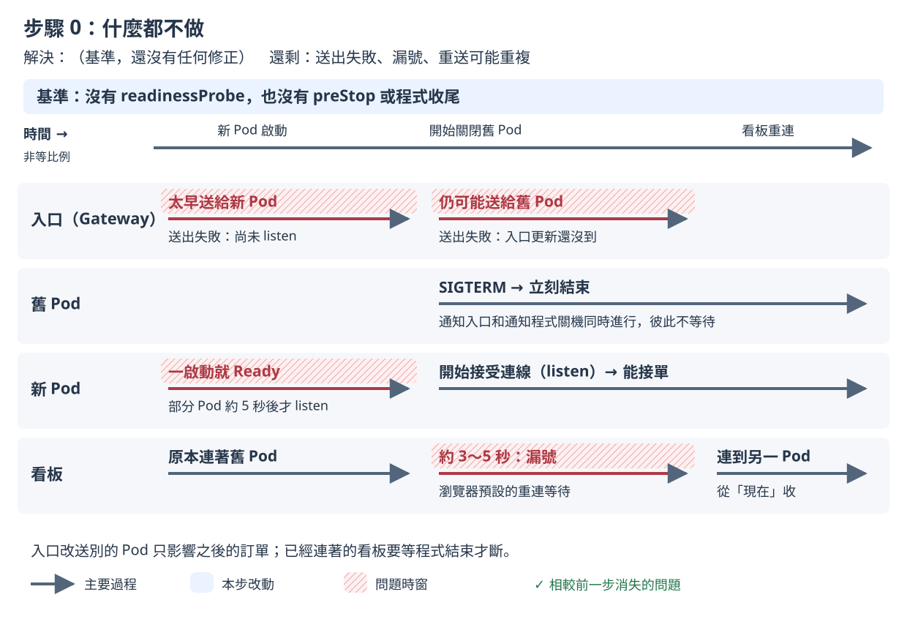

# 步驟 0：什麼都不做

## 這一步要解決什麼

先不修任何東西，量出 Kubernetes 預設的 rolling update（逐步把舊 Pod 換成新 Pod）會出多少問題，當作後面每一步比較的基準。

## 開始之前

- 已經做完[小實驗](00-idle-lab.md)。
- **先跑 control（對照組）而且通過**：control 和這一步的設定一樣，只是不升級，必須全部是 0。為什麼要先跑、沒通過怎麼辦，見[量測說明的 control](measure.md#control對照組)。

  ```bash
  ./measure.sh control --runs 2
  ```

- 不用手動改 YAML 或執行 `kubectl apply`，因為 `measure.sh` 會自己套用 `k8s/base`，並先把映像檔設回 v1。

開好三個視窗（`<IP>` 的查法見 [README 2. 部署](../../README.md#2-部署)）：

| 視窗 | 內容 | 必要？ |
|---|---|---|
| 終端機 A | `./measure.sh step-0 --runs 2` | 必要 |
| 終端機 B | `kubectl -n koupa get pods -w` | 建議 |
| 瀏覽器（要連得到 Gateway IP，例如主機上的瀏覽器或課程的 desktop container） | 只開 `http://<IP>/board?debug=1` | 選用，只看不操作 |

- 看板要在終端機 A 印出 `sending started` 之前打開。看板只會顯示連線期間叫到的號碼。量測前 `measure.sh` 套用設定時 Pod 也會換一輪，看板先斷線再自動連上是正常的。
- 客人、廚房和 3 台看板都由 Rush Hour 模擬，瀏覽器只是讓你觀察。**量測期間只看看板，不要操作點餐頁和廚房頁**，因為 Rush Hour 模擬的店員會自己按「完成」，而你自己下的單不在 Rush Hour 的紀錄裡，不會算進成績單。

## 改了什麼

沒有修改，用的是 `k8s/base`。和後面步驟有關的預設值（見 `k8s/base/deployment.yaml`）：

- 沒有 `readinessProbe`：container 一啟動，Pod 就算 Ready（可以接收流量）；
- 沒有 `preStop`：Pod 一被刪除，程式就收到 SIGTERM（Kubernetes 通知程式關機的訊號）；
- 沒有設定 `terminationGracePeriodSeconds`（關機寬限時間，超過就強制結束），用 Kubernetes 的預設 30 秒；
- 沒有 `strategy`，用預設的 rolling update：3 個 Pod 時，先多開 1 個新 Pod，等它 Ready 才關掉 1 個舊 Pod；
- 環境變數只有資料庫連線，以及 Pod 的名稱和 UID，App 的環境變數開關（`GRACEFUL_SHUTDOWN`、`RESUME_FROM_LAST_ID`、`IDEMPOTENCY_KEY`）都沒打開。

選用：看完整的 YAML：

```bash
kubectl kustomize k8s/base
```

## 怎麼做

在 `01/` 目錄執行：

```bash
./measure.sh step-0 --runs 2
```

`--runs 2` 是課堂上的建議次數；不加的話預設 5 次，講師的正式紀錄用 5 次。步驟 0 收尾時有比較多「結果未知」的請求要等，一次約 3.5 分鐘，2 次約 7 分鐘。

## 過程中看什麼

以下是 2026-11-11 在 tkha 上的一次實測（v1.2.2 → v2.2.2），時間從開始送單算起。

**終端機 A**：

```
[measure 18:35:50] preflight: all 7 checks passed
[measure 18:35:52] sending started at 2026-11-11T10:35:52.035567869Z
[measure 18:36:02] second 10: set image ghcr.io/braveantony/koupa:v2.2.2
[measure 18:36:10] set image ghcr.io/braveantony/koupa:v2.2.2 complete at second 18.6
```

最後還有一行 `step 0 observed: …`，列出這次量到的問題。結尾有 `Z` 的時間是 UTC，比台灣時間慢 8 小時；證據包的 `timeline.txt` 也用 UTC。

**終端機 B**：這次實測中，新 Pod 顯示 `ContainerCreating`（正在建立 container）之後，下一個觀察到的狀態就是 `1/1 Running`（READY 欄：Pod 裡 1 個 container 中有 1 個 Ready；`0/1` 表示還不能接收流量）。你的畫面可能略有不同；重點是沒有 `readinessProbe` 時，container 一啟動就算 Ready。接著一個舊 Pod 進入 `Terminating`，1 秒內就變成 `Completed`。

表中用 Pod 名稱的最後 5 碼代表，你的名稱會不同。

| 時間 | 新 Pod | 舊 Pod |
|---|---|---|
| 第 10 秒 | `lcvcb` 建立 | |
| 第 13 秒 | `lcvcb` `1/1` | `bxfl9` `Terminating` → `Completed` |
| 第 16 秒 | `85qvt` `1/1` | `92d9k` `Terminating` → `Completed` |
| 第 18 秒 | `b9tlm` `1/1` | `pflqf` `Terminating` → `Completed` |

**瀏覽器的看板**：看畫面底部的資訊列。

| 時間 | 資訊列 |
|---|---|
| 一開始 | `SSE 已連線`，`服務版本：v1.2.2`，`Pod：koupa-655986d64b-pflqf` |
| 第 19 秒 | `SSE 連線中斷，瀏覽器正在重新連線…`（`pflqf` 被關掉） |
| 第 22 秒 | `SSE 已連線`，`服務版本：v2.2.2`，`Pod：koupa-76c5b69579-lcvcb` |

斷線約 3～5 秒（瀏覽器自己的預設：Chromium 3 秒、Firefox 5 秒；這次的觀察用 Chromium）。重新連上後，右邊的大號碼會直接跳號（這次從 3393 跳到 3479 附近），斷線期間叫到的號碼不會出現。

## 你應該看到

講師量 5 次的結果（2026-11-10）。數字是中位數，括號內是範圍：

| 項目 | 步驟 0 |
|---|---|
| 第一次送出沒有成功回應 | **51 張（8～53）** |
| 重試後仍沒有成功回應 | 3 張（1～6） |
| 漏號（每台看板） | 已確認 12～83；5 次中有 4 次另有未知 |
| 重複訂單 | 已確認 0；5 次都另有未知（每次 8～53 筆伺服器端結果未知） |

數字每次差很多，因為碰到「晚 5 秒才準備好」的新 Pod 時，送出失敗會多出幾十張；沒碰到的那一次只有 8 張。原因見[步驟 1](step-1.md)。

你量的 2 次只要出現送出失敗或漏號，就算吻合。另一次實測（2026-11-11）沒碰到晚 5 秒才準備好的新 Pod，送出失敗 9 張、每台看板漏號已確認 76～80 個（另有 3～7 個未知）。

**步驟 0 的門檻**：2 次加起來至少要觀察到一個問題（送出失敗、漏號或重複訂單）。一個都沒有時，`measure.sh` 印出「對照組不成立」並以結束碼 3 結束，後面的步驟就看不出效果。

成績單上「已確認」和「未知」的讀法見[量測說明的成績單](measure.md#成績單)。

## 為什麼會這樣



Pod 被關掉時，「通知入口別再送過來」和「通知程式關機」是同時進行的，彼此不會等對方完成：

- **送出失敗**：程式收到 SIGTERM 就立刻結束，處理到一半的訂單跟著中斷；入口還沒收到更新，又把新訂單送給它。新 Pod 那一端也一樣：它一啟動就算 Ready，入口馬上把訂單送過去，但有些新 Pod 還沒準備好（程式還沒開始接受連線，圖上寫「尚未 listen」）。
- **漏號**：看板連在舊 Pod 上，程式一結束就斷線。看板重新連線後從「現在」開始收，斷線期間的叫號就漏掉了。
- **重複訂單的「未知」**：客人沒收到成功回應時，量測工具沒有足夠的紀錄證明這張訂單「沒有」進資料庫，就記成未知，不會算成 0。

完整說明見[設計文件 4.4 步驟 0：基準](../design-v2/04-step-mechanisms.md#44-步驟-0基準)。

## 出問題時

- **control 沒有通過（結束碼 3）**：不要往下量，見[量測說明的 control](measure.md#control對照組)。
- **步驟 0 一個問題都沒觀察到（結束碼 3）**：這個環境量不出升級的問題。多量幾次（`--runs 5`），還是沒有就請講師確認。
- **終端機 A 印出「量測前核對不符」**：量測還沒開始就停下來，結束碼 1，沒有量到任何東西。到該次證據包看 `preflight.txt` 裡 `FAIL` 開頭的那一行。
- **想知道每一張送出失敗是怎麼回事**：加上 `--verbose`，成績單會多印診斷資訊；也可以看證據包的 `failures.json` 和 `timeline.txt`。證據包在 `evidence/<量測編號>/`，2 次的彙整表在 `evidence/summary-step-0-<時間>.txt`。

查看上一個指令的結束碼：`echo $?`。其他狀況見[量測說明的結束碼](measure.md#結束碼和常見錯誤)。

---

[← 量測說明](measure.md)｜[回 README](../../README.md)｜[步驟 1 →](step-1.md)
