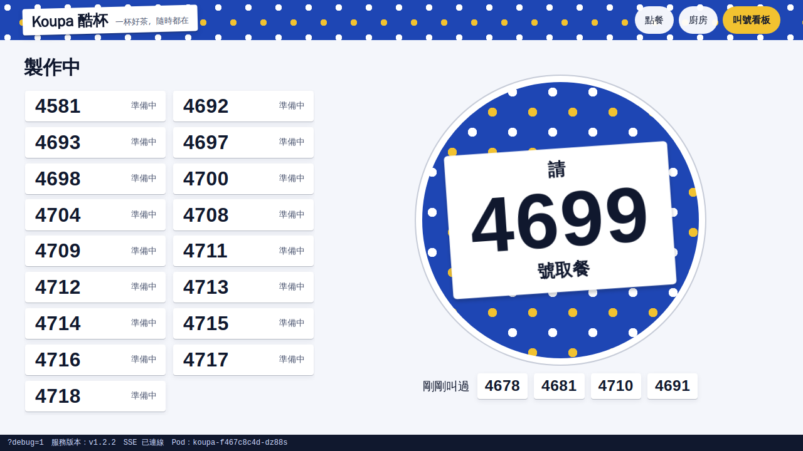
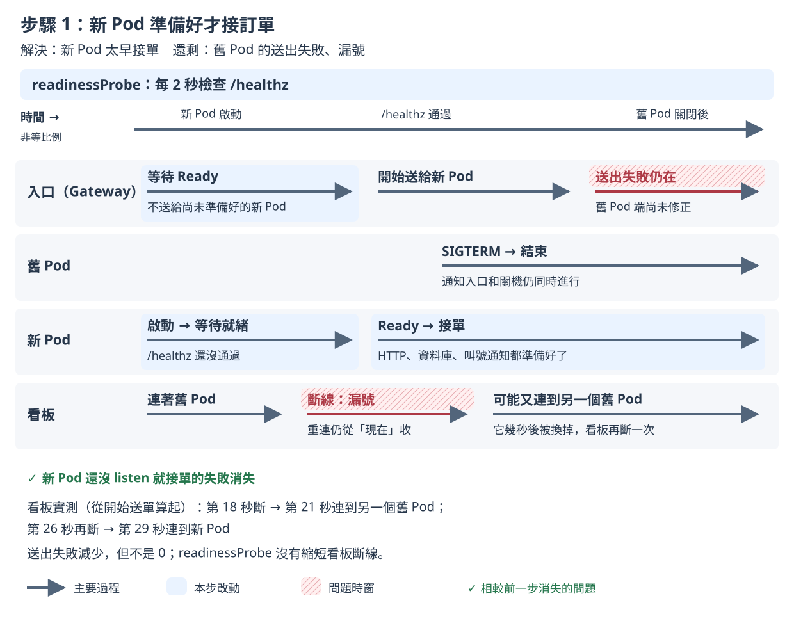

# 步驟 1：新 Pod 準備好才接訂單

## 這一步要解決什麼

讓入口只把訂單送給已經準備好的新 Pod。

步驟 0 留下的問題：送出失敗中位數 51 張，其中「送給還沒準備好的新 Pod」這一類的中位數就占了 42 張；每台看板也有數十個漏號。這一步只處理前者，漏號留到步驟 3、4。

## 開始之前

- 已經做完[步驟 0](step-0.md)，而且 control（對照組）通過，見[量測說明](measure.md)。
- 不用手動改 YAML 或執行 `kubectl apply`，因為 `measure.sh` 會自己套用這一步的設定，並先把映像檔設回 v1。

開好三個視窗（`<IP>` 的查法見 [README 2. 部署](../../README.md#2-部署)）：

| 視窗 | 內容 | 必要？ |
|---|---|---|
| 終端機 A | `./measure.sh step-1 --runs 2` | 必要 |
| 終端機 B | `kubectl -n koupa get pods -w` | 建議 |
| 瀏覽器（例如 desktop container 裡的 Firefox） | 只開 `http://<IP>/board?debug=1` | 選用，只看不操作 |

- 看板要在終端機 A 印出 `sending started` 之前打開。看板只會顯示連線期間叫到的號碼。量測前 `measure.sh` 套用設定時 Pod 也會換一輪，看板先斷線再自動連上是正常的。
- 客人、廚房和 3 台看板都由 Rush Hour 模擬，瀏覽器只是讓你觀察。**量測期間只看看板，不要操作點餐頁和廚房頁**，因為 Rush Hour 模擬的店員會自己按「完成」，而你自己下的單不在 Rush Hour 的紀錄裡，不會算進成績單。

## 改了什麼

在步驟 0（`k8s/base`）的 Deployment 上加一個 `readinessProbe`（Kubernetes 用來判斷 Pod 能不能開始接收流量的檢查）。`k8s/steps/step-1/kustomization.yaml` 修改的內容：

```yaml
readinessProbe:
  httpGet:
    path: /healthz
    port: 8080
  periodSeconds: 2      # 每 2 秒問一次
  timeoutSeconds: 1
  failureThreshold: 1   # 失敗一次就不 Ready
  successThreshold: 1   # 成功一次就 Ready
```

`/healthz` 要三件事都成立才會回應成功：HTTP 伺服器已經啟動、資料庫有回應、接收叫號通知的 `LISTEN` 已經生效。這一步沒有打開 App 的環境變數開關。

看完整的差異（只會多出上面這段）：

```bash
diff <(kubectl kustomize k8s/base) <(kubectl kustomize k8s/steps/step-1)
```

## 怎麼做

在 `01/` 目錄執行：

```bash
./measure.sh step-1 --runs 2
```

`--runs 2` 是課堂上的建議次數；不加的話預設 5 次，講師的正式紀錄用 5 次。步驟 1 收尾時有比較多「結果未知」的請求要等，一次約 3.5 分鐘，2 次約 7 分鐘。

## 過程中看什麼

以下是 2026-11-11 在 tkha 上的一次實測（v1.2.2 → v2.2.2），時間從開始送單算起。

**終端機 A**：

```
[measure 18:39:55] preflight: all 7 checks passed
[measure 18:39:59] sending started at 2026-11-11T10:39:59.717423446Z
[measure 18:40:09] second 10: set image ghcr.io/braveantony/koupa:v2.2.2
[measure 18:40:26] set image ghcr.io/braveantony/koupa:v2.2.2 complete at second 26.7
```

第 10 秒開始升級。這次在第 26.7 秒完成，同一天步驟 0 是第 18.6 秒。因為每個新 Pod 都要等檢查通過才算 Ready，升級也跟著變慢。

**終端機 B**：新 Pod 先是 `0/1 Running`，過一會兒才變成 `1/1 Running`。新 Pod 變成 `1/1` 之後，才有一個舊 Pod 進入 `Terminating`，約 1 秒內變成 `Completed`。

| 時間 | 新 Pod | 舊 Pod |
|---|---|---|
| 第 10 秒 | `9cm2q` 建立，`0/1 Running` | |
| 第 18 秒 | `9cm2q` `1/1` | `5wt8w` `Terminating` → `Completed` |
| 第 18 秒 | `g4mjd` 建立，`0/1 Running` | |
| 第 25 秒 | `g4mjd` `1/1` | `dz88s` `Terminating` → `Completed` |
| 第 25～26 秒 | `bvhvp` 建立，約 1 秒後 `1/1` | `9rzgr` `Terminating` → `Completed` |

`9cm2q` 和 `g4mjd` 從 `0/1` 到 `1/1` 花了 7～8 秒。App 的紀錄顯示，它們啟動後約 5 秒才連上資料庫，也就是步驟 0 那種「晚 5 秒才準備好」的 Pod。有了 `readinessProbe`，它們在這段時間一直是 `0/1`，入口不會把訂單送過去。

**瀏覽器的看板**：看畫面底部的資訊列。這次看板**斷線兩次**：

| 時間 | 資訊列 |
|---|---|
| 第 18 秒 | `SSE 連線中斷，瀏覽器正在重新連線…`（原本連著的舊 Pod `5wt8w` 被關掉） |
| 第 21 秒 | `SSE 已連線`，`服務版本：v1.2.2`，`Pod：koupa-f467c8c4d-dz88s`：重新連上的是**另一個還沒換掉的舊 Pod** |
| 第 26 秒 | 再一次 `SSE 連線中斷…`（`dz88s` 也被關掉） |
| 第 29 秒 | `SSE 已連線`，`服務版本：v2.2.2`，`Pod：koupa-64d7455689-9cm2q` |

每次斷線約 3 秒。重新連上後，右邊的大號碼會直接跳號（這次從 4598 跳到 4656 附近），斷線期間叫到的號碼不會出現。



第一次重連後的看板：版本還是 v1.2.2，Pod 名稱換成另一個舊 Pod。

## 你應該看到

講師量 5 次的結果（2026-11-10）。數字是中位數，括號內是範圍：

| 項目 | 步驟 1 | 對照：步驟 0 |
|---|---|---|
| 第一次送出沒有成功回應 | **7 張（4～12）** | 51 張（8～53） |
| 重試後仍沒有成功回應 | 0 | 3 張（1～6） |
| 漏號（每台看板） | 已確認 25～164；5 次中有 4 次另有未知 | 已確認 12～83；5 次中有 4 次另有未知 |
| 重複訂單 | 已確認 0；5 次都另有未知（每次 4～12 筆伺服器端結果未知） | 已確認 0；5 次都另有未知（每次 8～53 筆） |

你量的 2 次落在這個範圍，或符合這個趨勢，就算吻合：送出失敗明顯比步驟 0 少，重試後仍沒有成功回應是 0，漏號沒有改善。另一次實測（2026-11-11）是送出失敗 4 張、每台看板漏號 74～81 個。

**「已確認」和「未知」怎麼讀**，以下面這段成績單為例：

```
本次有 11 項結果無法確定，見診斷資訊；未標示未知的項目不受影響
...
  board-1：已確認 78；另有 1 個叫號未知
  board-2：74
```

`board-1` 確定漏掉 78 個，另外 1 個判斷不出來，不會算成 0，也不會算成漏號。`board-2` 沒有未知，74 就是結果。量 2 次以上時，彙整表遇到含未知的項目會寫「無法計算（另有 N 次含未知，未列入）」，不計入中位數。

## 為什麼會這樣



- **沒有 `readinessProbe` 時**：container 一啟動，Pod 就算 Ready，入口馬上把訂單送過去。在 tkha 上約 3 成的新 Pod 啟動後 5 秒才準備好（第一個 DNS 查詢被丟掉，要等 5 秒後重新查詢），這段時間送過去的訂單全部失敗。
- **加上之後**：`/healthz` 通過才 Ready，入口才會把它列為可以接收訂單的 Pod。Kubernetes 的 rolling update（逐步把舊 Pod 換成新 Pod）也會等新 Pod Ready 才關下一個舊 Pod，所以升級變慢。
- **剩下的送出失敗**：主要在**舊 Pod** 上。程式收到 SIGTERM（Kubernetes 通知程式關機的訊號）就立刻結束，但入口還沒收到更新，又把訂單送給它。這個問題留給步驟 2 處理。
- **漏號沒有改善**：看板連在舊 Pod 上，程式一結束就斷線。看板透過入口重新連線時，可能連到另一個還沒換掉的舊 Pod，所以會斷兩次。每次重連都從「現在」開始收，斷線期間的叫號就漏掉了。這個問題留給步驟 3、4 處理。

完整說明見[設計文件 4.5 步驟 1：readinessProbe](../design-v2/04-step-mechanisms.md#45-步驟-1readinessprobe)。

## 出問題時

- **新 Pod 一直停在 `0/1`**：`/healthz` 沒有通過。查原因：

  ```bash
  kubectl -n koupa describe pod <Pod 名稱>    # 看最下面 Events 的 Readiness probe failed
  kubectl -n koupa logs <Pod 名稱>
  ```

  如果升級到第 50 秒（送單時間 60 秒減 10 秒）還沒完成，這次量測就無效，終端機 A 印出「rollout 在第 50 秒（D − 10）前沒有完成」，最後以結束碼 2 結束。
- **終端機 A 印出「量測前核對不符」**：量測還沒開始就停下來，結束碼 1，沒有量到任何東西。到該次證據包看 `preflight.txt` 裡 `FAIL` 開頭的那一行。
- **想知道每一張送出失敗是怎麼回事**：加上 `--verbose`，成績單會多印診斷資訊；也可以看證據包的 `failures.json`。證據包在 `evidence/<量測編號>/`，2 次的彙整表在 `evidence/summary-step-1-<時間>.txt`。
- **control 沒有通過，還想繼續量**：加上 `--diagnostic`，每張成績單第一行會標「診斷模式：對照組不成立，不可用於比較」，數字只能用來排查。

查看上一個指令的結束碼：`echo $?`。其他狀況（control 的結束碼 3、證據包的檔案）見[量測說明](measure.md)。

---

[← 步驟 0](step-0.md)｜[回 README](../../README.md)｜[步驟 2 →](step-2.md)
