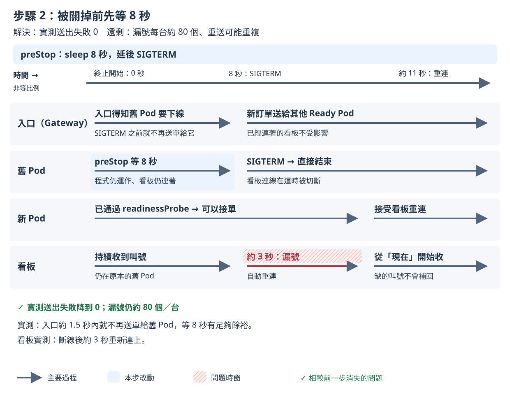

# 步驟 2：被關掉前先等幾秒

## 這一步要解決什麼

讓舊 Pod 晚幾秒才收到 SIGTERM，先讓入口停止把新訂單送給它。

步驟 1 留下的問題：送出失敗剩中位數 7 張，主要發生在**舊 Pod** 上：程式收到 SIGTERM（Kubernetes 通知程式關機的訊號）之後，入口還在把訂單送給它。漏號也還沒改善。

## 做之前

- 已經做完[步驟 1](step-1.md)。
- 不用手動改 YAML 或執行 `kubectl apply`：`measure.sh` 會自己套用這一步的設定，並先把映像檔設回 v1。

開好三個視窗（`<IP>` 的查法見 [README 2. 部署](../../README.md#2-部署)）：

| 視窗 | 內容 | 必要？ |
|---|---|---|
| 終端機 A | `./measure.sh step-2 --runs 2` | 必要 |
| 終端機 B | `kubectl -n koupa get pods -w` | 建議 |
| 瀏覽器（例如 desktop container 裡的 Firefox） | 只開 `http://<IP>/board?debug=1` | 選用，只看不操作 |

- 看板要在終端機 A 印出 `sending started` 之前打開。看板只會顯示它連著的時候叫到的號碼。量測前 `measure.sh` 套用設定時 Pod 也會換一輪，看板先斷線再自動連上是正常的。
- 客人、廚房和 3 台看板都由 Rush Hour 模擬，瀏覽器只是讓你看。**量測期間只看看板，不要操作點餐頁和廚房頁**：Rush Hour 的店員會自己按「完成」；自己下的單不在 Rush Hour 的紀錄裡，不會算進成績單。

## 改了什麼

在步驟 1 上加 `preStop`（Pod 被關掉前先執行的動作）：等 8 秒。`k8s/steps/step-2/kustomization.yaml` 的修改：

```yaml
template:
  metadata:
    annotations:
      koupa.dev/prestop-calibrated: "true"   # 8 秒是在這個環境校正出來的
  spec:
    containers:
      - name: koupa
        lifecycle:
          preStop:
            sleep:
              seconds: 8
```

`koupa.dev/prestop-calibrated` 只是標記，成績單會依它印出「preStop：8 秒（已依本環境校正）」。關機寬限時間維持預設 30 秒。這一步沒有打開 App 的環境變數開關。

看完整的差異：

```bash
diff <(kubectl kustomize k8s/steps/step-1) <(kubectl kustomize k8s/steps/step-2)
```

## 怎麼做

在 `01/` 目錄執行：

```bash
./measure.sh step-2 --runs 2
```

`--runs 2` 是課堂上的建議次數；不加時預設 5 次，講師的正式紀錄用 5 次。2026-11-10 實測一次約 1.5 分鐘，2 次約 3 分鐘。

## 過程中看什麼

以下是 2026-11-11 在 tkha 上的一次實測（v1.2.2 → v2.2.2），時間從開始送單算起。

**終端機 A**：

```
[measure 18:43:47] preflight: all 7 checks passed
[measure 18:43:48] sending started at 2026-11-11T10:43:48.595365388Z
[measure 18:43:58] second 10: set image ghcr.io/braveantony/koupa:v2.2.2
[measure 18:44:09] set image ghcr.io/braveantony/koupa:v2.2.2 complete at second 21.2
```

**終端機 B**：和前兩步最大的差別是舊 Pod **停在 `Terminating` 約 8 秒**才變成 `Completed`（步驟 0、1 是 1 秒內）。這 8 秒就是 `preStop` 在等。新 Pod 一樣先 `0/1 Running`，檢查通過才 `1/1`。

| 時間 | 新 Pod | 舊 Pod |
|---|---|---|
| 第 13 秒 | `zkvgs` `1/1` | `v87v9` `Terminating` |
| 第 20 秒 | `rpp6v` `1/1` | `j4lq2` `Terminating` |
| 第 21 秒 | `bqxp2` `1/1` | `v87v9` `Completed`（等了約 8 秒）；`dtrxk` `Terminating` |
| 第 28～29 秒 | | `j4lq2`、`dtrxk` `Completed` |

**瀏覽器的看板**：畫面底部的資訊列。

| 時間 | 資訊列 |
|---|---|
| 一開始 | `SSE 已連線`，`服務版本：v1.2.2`，`Pod：koupa-585fb7758-v87v9` |
| 第 22 秒 | `SSE 連線中斷，瀏覽器正在重新連線…`（`v87v9` 等完 8 秒、程式結束） |
| 第 25 秒 | `SSE 已連線`，`服務版本：v2.2.2`，`Pod：koupa-5bf9d54d7f-bqxp2` |

看板在舊 Pod 變成 `Completed` 前後才斷線，不是 `Terminating` 一開始就斷：等待的 8 秒內連線還在。斷線約 3 秒，和步驟 0、1 一樣。

## 你應該看到

講師 5 次的結果（2026-11-10），中位數（括號內是範圍）：

| 項目 | 步驟 2 | 對照：步驟 1 |
|---|---|---|
| 第一次送出沒有成功回應 | **0** | 7 張（4～12） |
| 重試後仍沒有成功回應 | 0 | 0 |
| 大螢幕漏號（每台看板） | **約 80 個（76～109）** | 已確認 25～164；4 次另有未知 |
| 重複訂單 | 0 | 已確認 0；另有未知 |

你的 2 次落在這個範圍、或符合這個趨勢，就算吻合：送出失敗變成 0（或接近 0），漏號**沒有減少**。另一次實測（2026-11-11）是送出失敗 0、每台看板漏號 78～84 個。

成績單第二行會是 `preStop：8 秒（已依本環境校正）`。

## 為什麼會這樣



- Pod 開始關閉時，「通知入口別再送過來」和「執行 `preStop`，執行完才送 SIGTERM」同時開始。入口要一點時間才收到更新。
- 等 8 秒，入口通常已經停止把新訂單送給這個 Pod，程式才收到 SIGTERM，訂單就不會送到一個正在結束的程式。
- 8 秒是用 `measure.sh calibrate` 在 tkha 上量出來的：推估入口最晚在刪除後 2.127 秒就不再選它，取整數再加 5 秒緩衝。換了環境要重新量。
- **漏號沒有減少**：看板還連在舊 Pod 上，8 秒後程式照樣直接結束，看板斷線、重連，斷線期間的叫號拿不到。這由步驟 3、4 處理。

完整說明見[設計文件 4.6 步驟 2：preStop](../design-v2/04-step-mechanisms.md#46-步驟-2prestop)。

## 出問題時

- **送出失敗不是 0**：加上 `--verbose` 看診斷資訊裡的「SIGTERM 之後才到的請求（每個 Pod）」。不是 0 表示 8 秒在你的環境可能不夠，請講師用 `measure.sh calibrate` 重新校正。
- **成績單寫「preStop 未經校正」或「未知」**：前者表示秒數是講師手冊的保守值，不是在這個環境量出來的；後者表示 Deployment 上沒有 `koupa.dev/prestop-calibrated` 標記。都請講師確認。
- **終端機 A 印出「量測前核對不符」**：量測還沒開始就停下來，結束碼 1，沒有量到任何東西。到該次證據包看 `preflight.txt` 裡 `FAIL` 開頭的那一行。
- **想看每個舊 Pod 的時間點**：證據包的 `timeline.txt` 列出每個被關掉的 Pod 何時開始終止、何時收到 SIGTERM、入口最後一次把請求送給它的時間。證據包在 `evidence/<量測編號>/`，2 次的彙整表在 `evidence/summary-step-2-<時間>.txt`。

查看上一個指令的結束碼：`echo $?`。其他狀況見[量測說明的結束碼](measure.md#結束碼和常見錯誤)。

---

[← 步驟 1](step-1.md)｜[回 README](../../README.md)｜[步驟 3 →](step-3.md)
