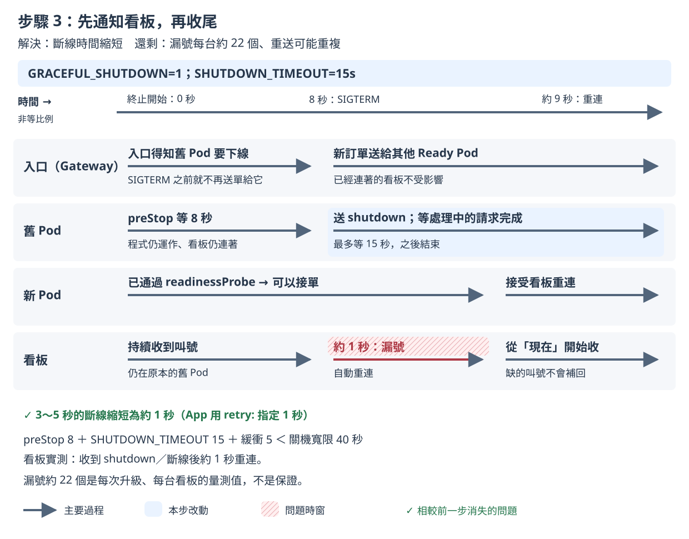

# 步驟 3：優雅關閉（graceful shutdown）

## 這一步要解決什麼

讓程式收到 SIGTERM 後先收尾、通知看板重新連線，再結束。

步驟 2 留下的問題：送出失敗已經是 0，但每台看板還是漏號約 80 個。8 秒後程式照樣直接結束，看板被硬生生切斷。

## 開始之前

- 已經做完[步驟 2](step-2.md)。
- 不用手動改 YAML 或執行 `kubectl apply`，因為 `measure.sh` 會自己套用這一步的設定，並先把映像檔設回 v1。

開好三個視窗（`<IP>` 的查法見 [README 2. 部署](../../README.md#2-部署)）：

| 視窗 | 內容 | 必要？ |
|---|---|---|
| 終端機 A | `./measure.sh step-3 --runs 2` | 必要 |
| 終端機 B | `kubectl -n koupa get pods -w` | 建議 |
| 瀏覽器（例如 desktop container 裡的 Firefox） | 只開 `http://<IP>/board?debug=1` | 選用，只看不操作 |

- 看板要在終端機 A 印出 `sending started` 之前打開。看板只會顯示連線期間叫到的號碼。量測前 `measure.sh` 套用設定時 Pod 也會換一輪，看板先斷線再自動連上是正常的。
- 客人、廚房和 3 台看板都由 Rush Hour 模擬，瀏覽器只是讓你觀察。**量測期間只看看板，不要操作點餐頁和廚房頁**，因為 Rush Hour 模擬的店員會自己按「完成」，而你自己下的單不在 Rush Hour 的紀錄裡，不會算進成績單。

## 改了什麼

在步驟 2 上打開 App 的 `GRACEFUL_SHUTDOWN` 開關，並加長關機寬限時間（`terminationGracePeriodSeconds`，超過就強制結束）。`k8s/steps/step-3/kustomization.yaml` 修改的內容：

```yaml
spec:
  terminationGracePeriodSeconds: 40
  containers:
    - name: koupa
      env:
        - name: GRACEFUL_SHUTDOWN
          value: "1"
        - name: SHUTDOWN_TIMEOUT
          value: 15s
```

- `GRACEFUL_SHUTDOWN`：收到 SIGTERM 後不再直接結束，先通知每台看板重新連線，並等處理中的請求做完；
- `SHUTDOWN_TIMEOUT`：收尾的期限，超過就不保證全部完成；
- 三段時間加起來要小於關機寬限時間：`preStop` 8 秒＋`SHUTDOWN_TIMEOUT` 15 秒＋緩衝 5 秒＜寬限時間 40 秒，程式才不會收尾到一半被強制結束。

看完整的差異：

```bash
diff <(kubectl kustomize k8s/steps/step-2) <(kubectl kustomize k8s/steps/step-3)
```

## 怎麼做

在 `01/` 目錄執行：

```bash
./measure.sh step-3 --runs 2
```

`--runs 2` 是課堂上的建議次數；不加的話預設 5 次，講師的正式紀錄用 5 次。依 2026-11-10 的實測，量一次約 1.5 分鐘，2 次約 3 分鐘。

## 過程中看什麼

以下是 2026-11-11 在 tkha 上的一次實測（v1.2.2 → v2.2.2），時間從開始送單算起。

**終端機 A**：

```
[measure 18:46:37] preflight: all 7 checks passed
[measure 18:46:38] sending started at 2026-11-11T10:46:38.505664327Z
[measure 18:46:48] second 10: set image ghcr.io/braveantony/koupa:v2.2.2
[measure 18:46:52] set image ghcr.io/braveantony/koupa:v2.2.2 complete at second 13.5
```

**終端機 B**：和步驟 2 一樣，舊 Pod 停在 `Terminating` 約 8 秒才變成 `Completed`。

| 時間 | 新 Pod | 舊 Pod |
|---|---|---|
| 第 11 秒 | `nxvgb` `1/1` | `sd52k` `Terminating` |
| 第 12 秒 | `kphtq` `1/1` | `fxh8r` `Terminating` |
| 第 13 秒 | `n5zdj` `1/1` | `kbs59` `Terminating` |
| 第 19～22 秒 | | `sd52k`、`fxh8r`、`kbs59` 依序 `Completed` |

**瀏覽器的看板**：看畫面底部的資訊列。

| 時間 | 資訊列 |
|---|---|
| 一開始 | `SSE 已連線`，`服務版本：v1.2.2`，`Pod：koupa-f55d67c7-sd52k` |
| 第 19 秒 | `SSE 連線中斷，瀏覽器正在重新連線…`（`sd52k` 等完 8 秒，收到 SIGTERM） |
| 第 20 秒 | `SSE 已連線`，`服務版本：v2.2.2`，`Pod：koupa-858b4db646-n5zdj` |

斷線時間從步驟 0～2 的 3 秒左右縮短到約 1 秒。斷線前，App 會先送出 `shutdown` 事件，資訊列可能會閃過 `SSE：伺服器即將重啟，等待瀏覽器重新連線…`；這段訊息通常顯示不到 1 秒，這次每秒截一張的截圖沒有拍到，但瀏覽器確實收到了這個事件。

## 你應該看到

講師量 5 次的結果（2026-11-10）。數字是中位數，括號內是範圍：

| 項目 | 步驟 3 | 對照：步驟 2 |
|---|---|---|
| 第一次送出沒有成功回應 | 0 | 0 |
| 重試後仍沒有成功回應 | 0 | 0 |
| 漏號（每台看板） | **約 22 個（18～41）** | 約 80 個（76～109） |
| 重複訂單 | 0 | 0 |

你量的 2 次落在這個範圍，或符合這個趨勢，就算吻合：送出失敗仍然是 0，漏號明顯比步驟 2 少，但還不是 0。另一次實測（2026-11-11）是每台看板漏號 16～21 個。

## 為什麼會這樣



- 程式收到 SIGTERM 後，先對每台看板送 `retry:`（建議瀏覽器多久後重連，預設 1 秒）和 `shutdown` 事件，再結束這條連線；同時等處理中的請求做完。
- 看板照 App 指定的時間，1 秒後重新連線，斷線時間變短，漏號跟著變少。
- **還是會漏號**：重連後仍然從「現在」開始收，斷線那 1 秒左右的叫號收不到。這個問題留給步驟 4 處理。

完整說明見[設計文件 4.7 步驟 3：Graceful shutdown](../design-v2/04-step-mechanisms.md#47-步驟-3graceful-shutdown)。

## 出問題時

- **終端機 A 印出「量測前核對不符」，`preflight.txt` 裡是 `FAIL timing`**：量測還沒開始就停下來，結束碼 1，沒有量到任何東西。原因是時間不符合 `preStop`＋`SHUTDOWN_TIMEOUT`＋緩衝 5 秒＜寬限時間。如果改過 `preStop` 的秒數，寬限時間也要一起調整。
- **漏號沒有變少**：加上 `--verbose`，看診斷資訊「大螢幕：」底下的斷線次數，分成「收到 shutdown 後斷線」和「沒收到 shutdown 就斷線」兩類。後者比較多時，表示看板沒收到通知就斷線了，請講師確認。
- **想看程式什麼時候收到 SIGTERM、什麼時候結束**：看證據包的 `timeline.txt`。證據包在 `evidence/<量測編號>/`，2 次的彙整表在 `evidence/summary-step-3-<時間>.txt`。

查看上一個指令的結束碼：`echo $?`。其他狀況見[量測說明的結束碼](measure.md#結束碼和常見錯誤)。

---

[← 步驟 2](step-2.md)｜[回 README](../../README.md)｜[步驟 4 →](step-4.md)
