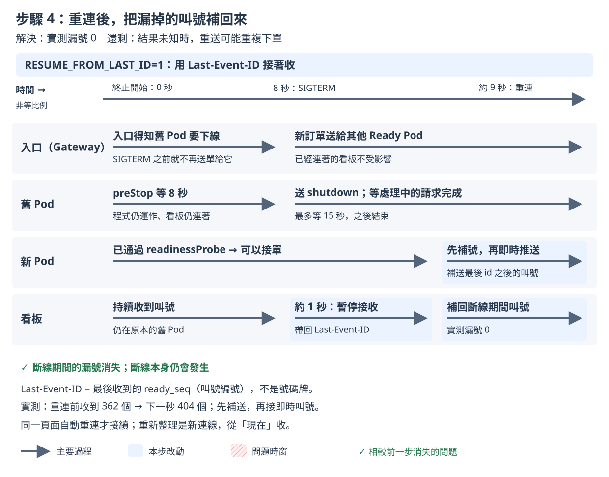

# 步驟 4：重連後補號

## 這一步要解決什麼

看板重新連線時，從斷掉的地方接回去，補收斷線期間的叫號。

步驟 3 留下的問題：斷線縮短到約 1 秒，但重連後還是從「現在」開始收，每台看板仍漏號約 22 個。

## 做之前

- 已經做完[步驟 3](step-3.md)。
- 不用手動改 YAML 或執行 `kubectl apply`：`measure.sh` 會自己套用這一步的設定，並先把映像檔設回 v1。

開好三個視窗（`<IP>` 的查法見 [README 2. 部署](../../README.md#2-部署)）：

| 視窗 | 內容 | 必要？ |
|---|---|---|
| 終端機 A | `./measure.sh step-4 --runs 2` | 必要 |
| 終端機 B | `kubectl -n koupa get pods -w` | 建議 |
| 瀏覽器（例如 desktop container 裡的 Firefox） | 只開 `http://<IP>/board?debug=1` | 選用，只看不操作 |

- 看板要在終端機 A 印出 `sending started` 之前打開。看板只會顯示它連著的時候叫到的號碼。量測前 `measure.sh` 套用設定時 Pod 也會換一輪，看板先斷線再自動連上是正常的。
- 客人、廚房和 3 台看板都由 Rush Hour 模擬，瀏覽器只是讓你看。**量測期間只看看板，不要操作點餐頁和廚房頁**：Rush Hour 的店員會自己按「完成」；自己下的單不在 Rush Hour 的紀錄裡，不會算進成績單。
- **量測期間不要重新整理看板**：補號只對同一個頁面的自動重連有效，重新整理是一次新的連線。

## 改了什麼

在步驟 3 上打開 App 的 `RESUME_FROM_LAST_ID` 開關。`k8s/steps/step-4/kustomization.yaml` 的修改：

```yaml
env:
  - name: RESUME_FROM_LAST_ID
    value: "1"
```

`RESUME_FROM_LAST_ID`：看板重連時帶來最後收到的叫號編號，App 從那個編號之後補送。

看完整的差異：

```bash
diff <(kubectl kustomize k8s/steps/step-3) <(kubectl kustomize k8s/steps/step-4)
```

## 怎麼做

在 `01/` 目錄執行：

```bash
./measure.sh step-4 --runs 2
```

`--runs 2` 是課堂上的建議次數；不加時預設 5 次，講師的正式紀錄用 5 次。2026-11-10 實測一次約 1.5 分鐘，2 次約 3 分鐘。

## 過程中看什麼

以下是 2026-11-11 在 tkha 上的一次實測（v1.2.2 → v2.2.2），時間從開始送單算起。

**終端機 A**：

```
[measure 18:49:38] preflight: all 7 checks passed
[measure 18:49:40] sending started at 2026-11-11T10:49:40.326166787Z
[measure 18:49:50] second 10: set image ghcr.io/braveantony/koupa:v2.2.2
[measure 18:49:55] set image ghcr.io/braveantony/koupa:v2.2.2 complete at second 15.1
```

**終端機 B**：和步驟 3 一樣，新 Pod 先 `0/1 Running` 再 `1/1`，舊 Pod 停在 `Terminating` 約 8 秒才變成 `Completed`。這一步沒有改 Kubernetes 的設定，Pod 的變化看不出差別。

**瀏覽器的看板**：畫面底部的資訊列。

| 時間 | 資訊列 |
|---|---|
| 一開始 | `SSE 已連線`，`服務版本：v1.2.2`，`Pod：koupa-79dbf9954-sshhm` |
| 第 21 秒 | `SSE 連線中斷，瀏覽器正在重新連線…`（`sshhm` 等完 8 秒，收到 SIGTERM） |
| 第 22 秒 | `SSE 已連線`，`服務版本：v2.2.2`，`Pod：koupa-6f65f76f67-cwbvn` |

和步驟 3 一樣斷線約 1 秒，畫面上看不出差別。差別在看板收到的叫號：重新連上的那 1 秒內，這台看板收到約 40 個叫號（步驟 3 同樣的 1 秒只有 6 個）：除了這 1 秒新叫的號，還有斷線期間被補送過來的。補送的號碼幾乎同時到達，畫面上只看得到最後幾個，所以眼睛看不出來，要看成績單。

## 你應該看到

講師 5 次的結果（2026-11-10），中位數（括號內是範圍）：

| 項目 | 步驟 4 | 對照：步驟 3 |
|---|---|---|
| 第一次送出沒有成功回應 | 0 | 0 |
| 重試後仍沒有成功回應 | 0 | 0 |
| 大螢幕漏號（每台看板） | **0**（5 次、3 台看板都是 0） | 約 22 個（18～41） |
| 重複訂單 | 0 | 0 |

你的 2 次漏號都是 0，就算吻合。另一次實測（2026-11-11）也全部是 0。0 的意思是「這幾次沒觀察到」，不代表不會發生。

## 為什麼會這樣



- 瀏覽器的看板自動重連時，會帶上最後收到的叫號事件編號（`Last-Event-ID`，也就是 `ready_seq`，不是畫面上的號碼牌）。
- 打開開關後，App 把它當作起點，先從資料庫補送之後的叫號，再接上即時推送，兩者之間不漏、不重複。開關關閉時，App 不理會這個編號，一律從「現在」開始。
- 只有同一個頁面的自動重連才會帶這個編號；重新整理網頁是一次新的連線，會從「現在」開始收。

完整說明見[設計文件 4.8 步驟 4：斷線重連後補號](../design-v2/04-step-mechanisms.md#48-步驟-4斷線重連後補號)。

## 出問題時

- **漏號不是 0**：先確認量測期間沒有人重新整理瀏覽器的看板（只影響你自己的看板，不影響成績單上的 3 台）。成績單上的 3 台看板有漏號時，加上 `--verbose` 看診斷資訊，並看證據包的 `timeline.txt`，請講師確認。
- **終端機 A 印出「量測前核對不符」**：量測還沒開始就停下來，結束碼 1，沒有量到任何東西。到該次證據包看 `preflight.txt` 裡 `FAIL` 開頭的那一行。
- 證據包在 `evidence/<量測編號>/`，2 次的彙整表在 `evidence/summary-step-4-<時間>.txt`。

查看上一個指令的結束碼：`echo $?`。其他狀況見[量測說明的結束碼](measure.md#結束碼和常見錯誤)。

---

[← 步驟 3](step-3.md)｜[回 README](../../README.md)｜[步驟 5 →](step-5.md)
