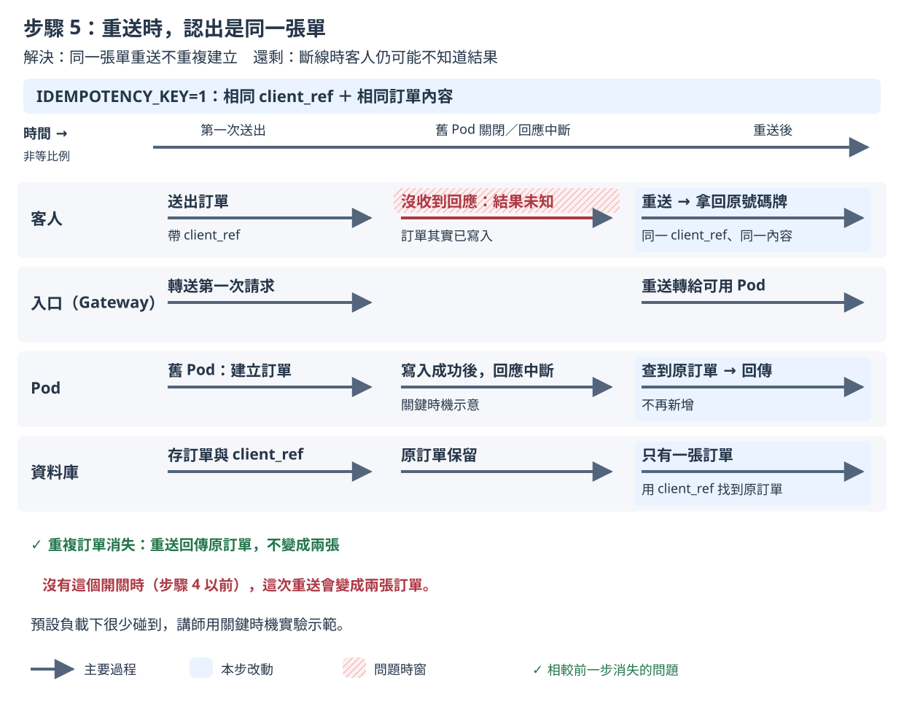

# 步驟 5：客人重送時，認出是同一張單

## 這一步要解決什麼

讓 App 在客人沒收到號碼牌就重送時，認出是同一張單，回傳原本的號碼牌，不會多做一份。

步驟 4 之後，成績單已經全部是 0。但 Kubernetes 的設定只能減少失敗，不能保證客人一定收到回應；回應在路上遺失時，客人重送就可能變成兩張訂單。這一步讓程式自己認出重送的訂單，同一次點餐重送時只會建立一張訂單。

## 開始之前

- 已經做完[步驟 4](step-4.md)。
- 不用手動改 YAML 或執行 `kubectl apply`，因為 `measure.sh` 會自己套用這一步的設定，並先把映像檔設回 v1。

開好三個視窗（`<IP>` 的查法見 [README 2. 部署](../../README.md#2-部署)）：

| 視窗 | 內容 | 必要？ |
|---|---|---|
| 終端機 A | `./measure.sh step-5 --runs 2` | 必要 |
| 終端機 B | `kubectl -n koupa get pods -w` | 建議 |
| 瀏覽器（要連得到 Gateway IP，例如主機上的瀏覽器或課程的 desktop container） | 只開 `http://<IP>/board?debug=1` | 選用，只看不操作 |

- 看板要在終端機 A 印出 `sending started` 之前打開。看板只會顯示連線期間叫到的號碼。量測前 `measure.sh` 套用設定時 Pod 也會換一輪，看板先斷線再自動連上是正常的。
- 客人、廚房和 3 台看板都由 Rush Hour 模擬，瀏覽器只是讓你觀察。**量測期間只看看板，不要操作點餐頁和廚房頁**，因為 Rush Hour 模擬的店員會自己按「完成」，而你自己下的單不在 Rush Hour 的紀錄裡，不會算進成績單。

## 改了什麼

在步驟 4 上打開 App 的 `IDEMPOTENCY_KEY` 開關。`k8s/steps/step-5/kustomization.yaml` 修改的內容：

```yaml
env:
  - name: IDEMPOTENCY_KEY
    value: "1"
```

`IDEMPOTENCY_KEY`：用點餐頁送來的訂單代碼（`client_ref`）認出重送的訂單，回傳原本的號碼牌。idempotency（冪等）的意思是同一個請求送幾次，結果都和送一次一樣。

看完整的差異：

```bash
diff <(kubectl kustomize k8s/steps/step-4) <(kubectl kustomize k8s/steps/step-5)
```

## 怎麼做

在 `01/` 目錄執行：

```bash
./measure.sh step-5 --runs 2
```

`--runs 2` 是課堂上的建議次數；不加的話預設 5 次，講師的正式紀錄用 5 次。依 2026-11-10 的實測，量一次約 1.5 分鐘，2 次約 3 分鐘。

## 過程中看什麼

以下是 2026-11-11 在 tkha 上的一次實測（v1.2.2 → v2.2.2），時間從開始送單算起。

**終端機 A**：

```
[measure 18:52:33] preflight: all 7 checks passed
[measure 18:52:35] sending started at 2026-11-11T10:52:34.969008987Z
[measure 18:52:44] second 10: set image ghcr.io/braveantony/koupa:v2.2.2
[measure 18:52:48] set image ghcr.io/braveantony/koupa:v2.2.2 complete at second 13.5
```

**終端機 B**：升級的過程和步驟 3、4 一樣。新 Pod 先 `0/1 Running` 再 `1/1`，舊 Pod 停在 `Terminating` 約 8 秒才變成 `Completed`（第 19～22 秒）。

這次還看到一件和升級無關的事：**第 40 秒左右，3 個新 Pod 同時變成 `0/1 Running`，約 1 秒後恢復 `1/1`**。App 的紀錄顯示，那時資料庫有大約 3 秒回應變慢，點餐和廚房按完成的請求，有些要 1～2.5 秒才完成，3 個 Pod 的 `/healthz` 都超過 1 秒的逾時上限，檢查失敗。這次的成績單仍然全部是 0。這不是步驟 5 造成的，其他步驟也可能遇到，說明見下面的「出問題時」。

**瀏覽器的看板**：看畫面底部的資訊列。

| 時間 | 資訊列 |
|---|---|
| 一開始 | `SSE 已連線`，`服務版本：v1.2.2`，`Pod：koupa-57cbc8c5cc-x5f8t` |
| 第 20 秒 | `SSE 連線中斷，瀏覽器正在重新連線…`（`x5f8t` 等完 8 秒，收到 SIGTERM） |
| 第 21 秒 | `SSE 已連線`，`服務版本：v2.2.2`，`Pod：koupa-7f64658cd-dqdxd` |

和步驟 3、4 一樣斷線約 1 秒。這一步改的是點餐，看板上看不出差別。

## 你應該看到

講師 5 次的結果（2026-11-10）：

| 項目 | 步驟 5 | 對照：步驟 4 |
|---|---|---|
| 第一次送出沒有成功回應 | 0 | 0 |
| 重試後仍沒有成功回應 | 0 | 0 |
| 漏號（每台看板） | 0 | 0 |
| 重複訂單 | 0 | 0 |

你量的 2 次和步驟 4 一樣全部是 0，就算吻合。另一次實測（2026-11-11）也全部是 0。

**為什麼成績單看不出差別**：2026-11-10 用預設負載做的 25 次量測（步驟 0～4）裡，已確認的重複訂單都是 0，其中步驟 0、1 另有伺服器端結果未知的訂單。要剛好碰上「訂單建好了、回應卻沒送到」才會重複，預設負載下很少發生。所以這一步的效果由講師用關鍵時機實驗（用測試開關讓請求剛好停在「訂單已寫入、回應還沒送出」的時候）示範：開關關閉時，同一次點餐變成兩張訂單；打開後，重送會拿回原本的號碼牌（見[實測紀錄第 5 節](../measurements/2026-11-10.md#5-關鍵時機實驗)）。

## 為什麼會這樣



- 點餐頁每次送出訂單前，會先產生一個隨機的 `client_ref`；沒收到成功回應而重送時，沿用同一個 `client_ref` 和同樣的內容。
- 打開開關後，建立訂單時先把 `client_ref` 寫進一張 `client_ref` 不能重複的資料表（`client_ref` 是主鍵）。同一個 `client_ref` 只有第一次會建立訂單；重送時回傳原本的號碼牌，即使兩個請求同時送到不同的 Pod 也一樣。
- 如果 `client_ref` 相同但內容不同，App 會回傳 HTTP 狀態碼 409（衝突），點餐頁會請客人重新下單。

完整說明見[設計文件 4.9 步驟 5：重送不重複下單](../design-v2/04-step-mechanisms.md#49-步驟-5重送不重複下單)。

## 出問題時

- **終端機 B 看到新 Pod 短暫變成 `0/1`，又自己恢復**：`readinessProbe` 失敗一次就不算 Ready（`failureThreshold: 1`），而 `/healthz` 會檢查資料庫有沒有回應。資料庫短暫變慢時，`/healthz` 超過 1 秒就算失敗，入口會暫時不把請求送給這個 Pod，下一次檢查通過就恢復。成績單沒有受影響時不用處理；有送出失敗時，加上 `--verbose` 看診斷資訊，並把證據包交給講師。
- **重複訂單不是 0**：看成績單寫的是「已確認」還是「伺服器端結果未知」（讀法見[量測說明的成績單](measure.md#成績單)）。如果是已確認的重複訂單，請講師確認開關有沒有生效。
- **終端機 A 印出「量測前核對不符」**：量測還沒開始就停下來，結束碼 1，沒有量到任何東西。到該次證據包看 `preflight.txt` 裡 `FAIL` 開頭的那一行。
- **想看原始紀錄**：證據包在 `evidence/<量測編號>/`，2 次的彙整表在 `evidence/summary-step-5-<時間>.txt`。

查看上一個指令的結束碼：`echo $?`。其他狀況見[量測說明的結束碼](measure.md#結束碼和常見錯誤)。

---

[← 步驟 4](step-4.md)｜[回 README](../../README.md)｜[最後驗證 →](final-checks.md)
